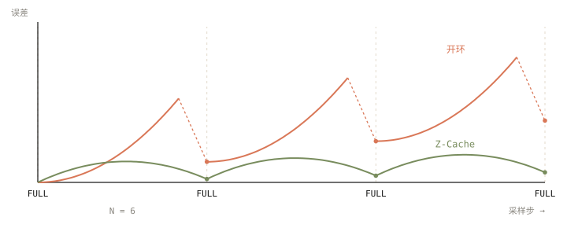
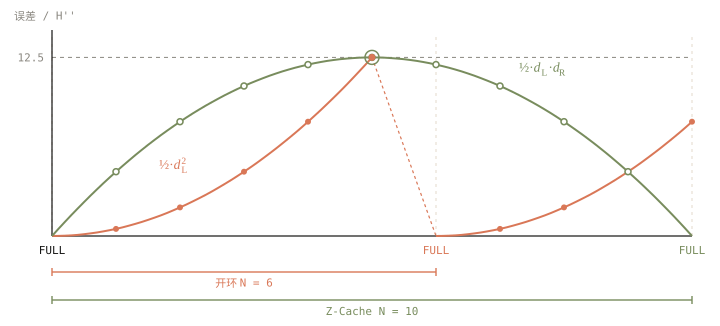

+++
title = 'Z-Cache 的系统账本：一个特征缓存近似，在显存、带宽与首帧延迟上意味着什么'
date = 2026-11-11
draft = false
summary = '从系统视角拆解 Z-Cache 双锚点自省缓存：同样的峰值误差下窗口跨度可从 6 拉到 10；Wan2.1-14B 720p 逐块缓存要约 93 GB，根残差嫁接只要 2.3 GB；H100 PCIe 实测重放 2.16 ms/step，全量步 18.97 s；以及少步流式场景下闭合约束带来的首帧延迟代价。'
tags = ['Diffusion', 'DiT', 'Feature Cache', 'Z-Cache', '推理加速', 'Roofline']
showReadingTime = true
showTableOfContents = true
+++



> 本文是对 [Z-Cache: Accelerating Diffusion Transformers via Self-Reflection](https://arxiv.org/abs/2611.01846) 的系统视角解读。我关心的不是「它为什么更准」，而是「这个近似放进推理系统后意味着什么」：要多少显存、吃多少带宽、会不会拖慢首帧。
>
> 数据口径：**[论文]** 为原文报告的数字；**[实测]** 为在单卡 NVIDIA H100 PCIe（80 GB）设备条件下、用随机权重的 Wan2.1 结构测得，只测耗时与显存，不评估画质；**[估算]** 为按公式口算。

先给三个数字：

- **同样的峰值误差，窗口跨度 N 可以从 6 拉到 10。** 50 步采样的全量步从 9～10 个降到 6～7 个。[估算]
- **Wan2.1-14B 720p 视频，逐块缓存要约 93 GB，根残差嫁接只要约 2.3 GB。** [估算 + 实测]
- **一次重放约 2 ms，一次全量步约 19 s。** [实测]

所以结论很直接：Z-Cache 的代价不在算力，而在**显存布局**和**时序约束**。下面一笔一笔算。

## 一、开环特征缓存为什么会漂移

DiT 推理的主要成本是每个去噪步都要跑一遍完整的 Transformer。特征缓存的思路是：相邻步的中间特征很像，那就每隔 N 步跑一次全量步（下文记作 FULL），中间的步用历史特征外推出来。FORA — 2024 直接复用，TaylorSeer — 2025 用有限差分做泰勒外推，都属于这一类「开环」方法：只看过去，不看未来。

在一个缓存窗口 \([a, b]\) 里，误差有两个来源，必须分开看：

1. **预测器截断误差**：用多项式外推特征带来的误差，离左锚点 \(a\) 越远越大。
2. **潜变量漂移 \(\delta\)**：用不准的特征推进采样器，潜变量 \(\bar x_i\) 一步步偏离真值，并且逐步累积。

到右锚点 \(b\)，全量步用真实网络权重计算，第 1 部分直接清零，只剩第 2 部分经过网络放大后的残差。所以逐层特征误差呈锯齿形：窗口内攀升，到 FULL 断崖下降。[论文 Fig.2]

问题在于开环方法接下来会直接提交 \(\bar x_{b+1}\)，于是**第 2 部分的漂移被永久带进后续轨迹**，每个窗口的「地板」都比上一个高一点。

## 二、Z-Cache 一页讲清：探路、融合、重放

Z-Cache 的想法是：既然 FULL 在 \(b\) 处拿到了「未来的真值」\(H_b\)，那就把它带回窗口内部，重新算一遍。

1. **Stage 1 探路**：照常开环跑到 \(b\)，把这段潜变量轨迹当作临时探测，拿到右锚点特征 \(H_b\)。
2. **Stage 2 融合**：左锚点预测器 \(B^p\) 往前外推，右锚点扩展状态 \(B^f\) 往回推，两者按窗口进度做凸组合：

$$\tilde H_i = (1 - w_i)\,C(B^p, i) + w_i\,C(B^f, i),\qquad w_i = \frac{i - a}{b - a}$$

权重只和位置有关，不需要任何超参。论文在 FLUX.1-dev、N=6 下对比了四种融合规则，SSIM 的极差只有 0.0014，线性权重就够了。[论文]

3. **Stage 3 重放**：丢掉探路得到的临时潜变量，从精确起点 \(x_{a+1}\) 出发，在 \(i \in [a+1, b]\) 共 \(N\) 步上（含 \(i=b\) 复用 \(H_b\) 更新终点）重新推进采样器，提交 \(\tilde x_{b+1}\)。

这里有一个容易忽略的反事实：**如果关掉重放，只算校准特征，收益是零。** 采样器只通过潜变量把特征的作用传到最终输出，校准后的 \(\tilde H_i\) 没进入任何一次采样器更新，提交的 \(\bar x_{b+1}\) 和 TaylorSeer 逐比特相同。特征校准只是「算出了正确答案」，重放才是「把答案交上去」。

## 三、误差形状：为什么窗口能拉长

假设特征轨迹的曲率 \(H''\) 在窗口内近似不变，记 \(d_L = i - a\)、\(d_R = b - i\)。两种方法的误差幅值形状（只给结论，不展开推导）：

| 方法 | 缓存步误差幅值 | 峰值位置 |
| :--- | :--- | :--- |
| 开环外推（TaylorSeer K=1，理想切线斜率） | \(\tfrac12\,d_L^2\,|H''|\) | 窗口尾，\(d_L = N-1\) |
| Z-Cache 双锚点插值（K=0，或 K=1 等宽割线底座） | \(\tfrac12\,d_L\,d_R\,|H''|\) | 窗口中点，大小 \(N^2/8\) |

开环相当于「只拽住一头」，误差在尾部最大；插值「两头都拽住」，误差只在中间鼓起来。

于是可以问一个系统问题：**要求峰值误差不变，窗口能拉多长？**

- 基线开环 N=6：峰值在 \(d_L = 5\)，为 \(\tfrac12 \times 25 = 12.5\)（以 \(|H''|\) 为单位）。
- Z-Cache：\(N^2/8 \le 12.5\)，N=10 时正好 12.5，N=11 时 \(\tfrac12 \times 5 \times 6 = 15\) 超标。

所以 **N 可以从 6 放到 10**。计入第六节将讲到的闭合右端锚点与预热步，50 步采样的全量步从 9～10 个降到 6～7 个（如 K=0 取 \(\{0,10,20,30,40,49\}\) 共 6 步，K=1 含预热步共 7 步）。按下文实测的 18.97 s/step，总耗时从约 171～190 s 降到约 114～133 s。[估算]

另一个角度是同样 N=6 下窗口内误差的总和：理想切线开环 \(\sum \tfrac12 d_L^2 = 27.5\)，双锚点插值 \(\sum \tfrac12 d_L d_R = 17.5\)，约降 36%。论文用 768 条同起点轨迹做局部对照，N=6 时窗口相对 L2 误差的 AUC 降低 29.6%。[论文] 两者量级吻合，但要注意底座斜率前提：若左端真有精确切线斜率 \(D_a^1 = H'_a\)，下文第四节的 K=1 预合并式会把二次误差完全抵消；真实 TaylorSeer 用的是上一等宽窗口的割线斜率，此时 Z-Cache K=1 的残差幅值退回 \(\tfrac12 d_L d_R |H''|\)，而开环割线外推误差会放大到 \(\tfrac12 d_L(N+d_L)|H''|\)，比上表给开环假设的理想切线基线更严苛。

这个结论依赖两个前提，N 拉得越大越容易失效：

- **曲率近似不变**：窗口越长，二阶近似之外的高阶项增长越快。
- **右锚点小位移**：\(H_b\) 是在漂移后的潜变量 \(\bar x_b\) 上算出来的。窗口越长，探路漂移越大，用来校准的「标准答案」本身就越不准。

## 四、显存账

### 两份状态必须同时留在显存里

开环方法到了 \(b\) 就可以扔掉 \(B^p\)。Z-Cache 不行：重放区间里每一步都要同时用到 \(B^p\) 和 \(B^f\)。以 K 阶 TaylorSeer 为底座，每份状态有 \(K+1\) 个张量，朴素实现每个缓存站点要存 \(2(K+1)\) 份。

但 \(B^f\) 里的每个差分系数都能由 \(B^p\) 和新观测 \(H_b\) 推出来，比如 \(D_b^1 = (H_b - H_a)/N\)，并没有带来新信息。所以：

> **每站点最少需要 \(K+2\) 份**：\(B^p\) 的 \(K+1\) 份，加上 \(H_b\) 这 1 份。

换个角度也能得到同样的数：\(w_i\) 关于 \(i\) 是线性的，所以 \(\tilde H_i\) 是关于步位移的 \(K+1\) 次多项式，恰好需要 \(K+2\) 个系数。以 K=1 为例，可以预合并为：

$$\tilde H_i = H_a + d_L\,D_a^1 + d_L^2\,D_b^2,\qquad D_b^2 = \frac{D_b^1 - D_a^1}{N}$$

只存 \(H_a\)、\(D_a^1\)、\(D_b^2\) 三份，重放时每步只剩一次融合乘加。朴素实现比最少份数多出 \(K\) 份，阶数越高越浪费。

### 缓存显存公式

把上面的乘法写成一条公式：

$$\text{Mem}_{\text{cache/GPU}} \approx \frac{S \times (K+2) \times L \times D \times \text{bytes} \times c_{\text{cfg}}}{P_{\text{sp}}}$$

其中 \(S\) 是缓存站点数，\(L\) 是 token 数，\(D\) 是隐藏维度，\(c_{\text{cfg}}\) 是 CFG 批倍数（1 或 2），\(P_{\text{sp}}\) 是序列并行度。融合与重放都是逐元素运算，每张卡只需存自己那 \(1/P\) 的 token 切片，不引入通信；但 Ulysses / Ring 下权重在每张卡上完整复制，不随 \(P\) 下降。

公式里**唯一能在 1 和几十之间跳变的是站点数 \(S\)**：

- **逐块后端**：每个 Transformer block 设站点，\(S\) 约等于层数（Wan2.1-14B 为 40；论文的 FLUX 实现约 95 个块内站点）。
- **根残差嫁接（Root-residual graft）**：只缓存整个 DiT 顶层的根残差，\(S = 1\)，重放时完全旁路所有 block。

为什么论文里图像模型逐块也能跑，到视频上就不行？因为单份大小差了一个数量级：

| 场景 | \(L\) | \(D\) | 单份（BF16） |
| :--- | ---: | ---: | ---: |
| FLUX 1024² | 约 4,608 | 3072 | 约 28 MB |
| Wan2.1-14B 720p·81 帧 | 75,600 | 5120 | 约 0.77 GB |

### 视频上要几张卡

以 Wan2.1-14B 720p、K=1 为例。实测单次前向峰值 37.3 GB，其中权重 28.6 GB、激活约 8.7 GB [实测]；按十进制 GB 保守计，单卡 H100-80GB 留给缓存的预算约 \(80 - 28.6 - 8.7 \approx 42.7\) GB（H100 标称 80 GiB 约合 85.9 GB，且激活随 SP 也会下降，实际余量更宽裕，下表 SP 档位不变）：

| 方案 | 缓存总量 | 不开 CFG 所需 SP | 开 CFG 所需 SP |
| :--- | ---: | :---: | :---: |
| graft，BF16 | 2.3 GB | 1 | 1 |
| 逐块 40 站点，BF16 | 92.9 GB | 4 | 8 |
| 逐块 40 站点，全 FP8 下界 | 46.4 GB | 2 | 4 |

结论：**视频高分辨率场景必须用 graft**。逐块方案为了装下缓存就要多拿 4～8 倍的卡。

### 要不要把缓存存成 FP8

- **graft 下不值得**：就算 3 份全存 FP8 也只省 1.16 GB；重放访存里只有读系数那部分减半，每步从约 2.16 ms 降到约 1.5 ms，N=6 每窗口省约 4 ms，占 19 s 全量步约 0.02%。优化一个本来就可以忽略的部分，没有意义（Amdahl）。
- **逐块下有用**：能把所需 SP 从 4 降到 2（开 CFG 从 8 降到 4）。
- **只量化差分项，保留 BF16 基底**：真做混合精度时应按 \(2+1+1\) 字节存储（逐块 40 站点约 61.9 GB，所需 SP 仍为 2 和 4；graft 省约 0.77 GB）。原因是量化误差的大小跟着被量化张量本身的幅值走：E4M3 只有 3 位尾数，单元素相对舍入误差可达约 6%。满幅值的 \(H_a\) 量化后，误差会原样加到每个 \(\tilde H_i\) 上，比 Z-Cache 要纠正的窗口误差还大；\(D_a^1\)、\(D_b^2\) 幅值小，同样的相对误差换算成绝对误差很小。这和 KV / 激活量化里「保留 base、量化 delta」是同一个道理。

## 五、时间账：Roofline 视角

graft 后端的一个重放步只做三件事：用预合并系数融合出 \(\tilde H_i\)；过输出头（AdaLN 调制的 LayerNorm、线性投影到 patch 通道、unpatchify）；采样器逐元素更新潜变量。

融合部分每个元素约 5 次浮点运算，却要搬 8～10 字节，算术强度不到 1 FLOP/B。H100 的脊点在几百 FLOP/B，差了两个多数量级，所以这是**纯带宽受限**的运算：耗时 ≈ 访存字节数 ÷ HBM 带宽。输出头的 GEMM 约 50 GFLOP，潜变量本身约 10 MB，都可以忽略。

实测（H100 PCIe，2 GiB 拷贝标定的带宽为 1.86 TB/s）：

| 实现 | 每步访存 | 实测 | 访存 ÷ 带宽 |
| :--- | ---: | ---: | ---: |
| eager | 中间张量多 | 12.24 ms | — |
| torch.compile | 读 3 份系数 + 写读 1 份归一化激活 ≈ 3.87 GB | **2.16 ms** | 2.08 ms |
| 理论全融合 | 只读 3 份系数 ≈ 2.32 GB | 未实现 | 1.25 ms |

torch.compile 把融合和调制的 LayerNorm 合成了一个 kernel，将归一化输出写回显存供投影 GEMM 读取，实测与「3.87 GB ÷ 带宽」的模型几乎完全吻合。它到不了 1.25 ms 的下界，是因为 LayerNorm 需要先沿 \(D=5120\) 完整归约均值与方差，难以直接塞进投影 GEMM 沿 \(D\) 分块的 prologue 里。不过下面会看到，手写这个融合 kernel 并不值得。

再看全量步（同一张卡，随机权重，720p·81 帧）[实测]：

| 模型 | 计算量（估算） | 全量步 | 折算算力 |
| :--- | ---: | ---: | ---: |
| Wan2.1-14B | 6.84 PFLOP | **18.97 s** | 361 TFLOPS（约峰值 48%） |
| Wan2.1-1.3B | 1.27 PFLOP | 3.77 s | 336 TFLOPS |

（表中计算量按 \(2 N_{\text{param}} L + 4 L^2 D n_{\text{layer}}\) 近似估算；扣除只作用在 512 个文本 token 上的 Cross-Attention K/V 权重后，14B 精确前向约 6.52 PFLOP、折算约 344 TFLOPS。）

于是 N=6 的一个窗口里，重放 6 步约 13 ms，全量步约 19 s，**重放只占约 0.07%**；就算用最朴素的 eager 实现，也只占约 0.4%。这和论文报告的「算术 FLOPs 增幅低于 0.2%」是一致的。[论文] Z-Cache 在时间上几乎不花钱。

论文里 graft 比逐块后端快约 20%、峰值显存少约 4%（FLUX.1-dev、TaylorSeer、N=6）[论文]。这部分差距来自逐块后端在几十个块内站点上的 hook 与读写开销，而不是算力。

## 六、时序账：首帧延迟与闭合约束

### 常规逐 chunk 生成：基本不受影响

Z-Cache 要等右锚点 \(b\) 的全量步完成，才能回滚重放、提交 \(\tilde x_{b+1}\)。这听起来会拖慢首帧，但一个 chunk 去噪过程中的中间潜变量本来就不对外交付，只有最后的 \(x_S\) 会送进 VAE。所以常规场景下，**回滚只多出毫秒级的重放时间，首帧延迟（TTFF）基本不变**。

### 少步场景：闭合约束迫使你多跑全量步

真正的代价在步数安排上：**每个被校准窗口的右端都必须是 FULL，最后一步也必须是 FULL**，否则尾部缓存步后面没有右锚点，只能退化为开环。步数多的时候这不算什么，但在 4～8 NFE 的蒸馏流式模型里，全量步的个数直接决定单 chunk 延迟：

| NFE | 方案 | FULL 集合 | 校准缓存步 | 单 chunk 延迟 |
| :---: | :--- | :--- | :---: | :--- |
| 4 | 不加速 | {0,1,2,3} | — | \(4\,t_{\text{full}}\) |
| 4 | 开环 | {0,2} | 0 | \(2\,t_{\text{full}}\) |
| 4 | Z-Cache K=0 | {0,2,3} | 1 | \(3\,t_{\text{full}}\) |
| 4 | Z-Cache K≥1 | {0,1,3} | 1 | \(3\,t_{\text{full}}\) |
| 8 | Z-Cache N=2 | {0,2,4,6,7} | 3 | \(5\,t_{\text{full}}\) |
| 8 | Z-Cache N=3 | {0,3,6,7} | 4 | \(4\,t_{\text{full}}\) |

（4 NFE 中 K≥1 的底座需要两个连续 FULL 才能构造出第一个差分斜率，所以是 {0,1,3}；表中 8 NFE 两行以 K=0 为例。）

几点观察：

- 4 NFE 下，Z-Cache 比激进的开环多 1 个全量步，TTFF 多 50%，换来的是画质。
- 8 NFE 下，N=3 比 N=2 少 1 个全量步，但窗口内峰值误差从 \(\tfrac12 \cdot 1 \cdot 1\) 变成 \(\tfrac12 \cdot 1 \cdot 2\)，翻倍；再加上蒸馏模型每步跨度大，二阶近似更容易失效。论文在 8 步的 Qwen-Image-Lightning 上实测的最优就是 N=2。[论文]

### 与跨步流水线冲突

有些系统在第 \(i\) 步还没完全结束时就开始消费它的中间结果：PipeFusion — 2024 的跨步 patch 流水，或者对角滚动去噪（下一个 chunk 读取上一个 chunk 的中间 noisy KV）。Z-Cache 的窗口回滚会让下游已经读走的中间状态作废，只剩两个选择：

- 让下游等窗口闭合，相当于加一道窗口级同步屏障，流水线退化成串行；
- 接受不一致，让未校准的漂移漏进下一个 chunk。

论文也把这一点列为局限。[论文]

## 七、部署决策清单

| 场景 | 建议 |
| :--- | :--- |
| 多步（≥ 20 步）离线生成 | 用 graft，N 取 5～10，额外代价可以忽略 |
| 高分辨率视频 | 必须用 graft；逐块方案需要 SP4 以上才装得下缓存 |
| 少步流式（4～8 NFE） | 只在画质是瓶颈时用，N 取 2；接受多一个全量步的 TTFF 代价 |
| 消费中间状态的跨步流水线 | 不建议叠加 |
| 已有二阶差分补偿的底座（如 D2Cache — 2025） | 边际收益收窄，N=6 时 ImageReward 甚至从 0.9536 降到 0.9415 [论文] |

## 八、局限与待验证

- 本文实测用的是随机权重，只验证耗时和显存，**不评估画质**；画质结论全部来自论文。
- 逐块后端的真实 hook 开销没有复现，「graft 快约 20%」是论文在 FLUX 上的数字。
- 误差形状基于曲率不变的二阶近似，大步长蒸馏模型需要实测轨迹来验证。
- 下一篇会把 Z-Cache 和 [SpeCa](https://arxiv.org/abs/2509.11628)（先预测再验证、动态决定是否跑全量步）放在一起，比较两种思路的系统代价。

## 附录：实测环境与脚本

- **硬件**：NVIDIA H100 PCIe 80 GB 单卡（BF16 稠密峰值约 756 TFLOPS，拷贝实测带宽 1.86 TB/s）。
- **软件**：torch 2.13 + CUDA 13.0，diffusers 0.42.1。
- **模型**：`WanTransformer3DModel` 随机初始化，1.3B / 14B 官方结构配置，720p·81 帧，latent 16×21×90×160，patch 后 L = 75,600。
- **脚本**：[zcache_s3_bench.py](/code/zcache_s3_bench.py)，单文件，`CUDA_VISIBLE_DEVICES=0 python zcache_s3_bench.py --model 14b` 即可复现。
- **方法**：全程关闭梯度；带宽标定与重放步用 CUDA event 计时（分别测 eager 与 torch.compile），全量步用 `torch.cuda.synchronize()` 配合主机高精度时钟计时（预热 1 次后取 2～3 次平均）。
