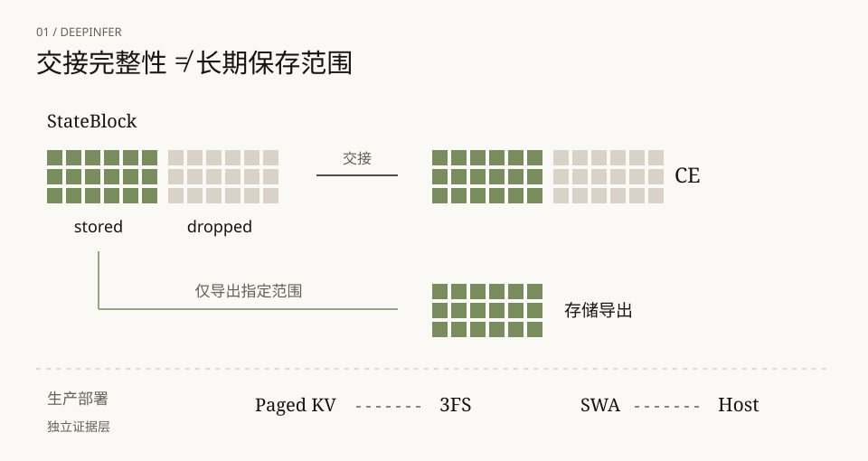
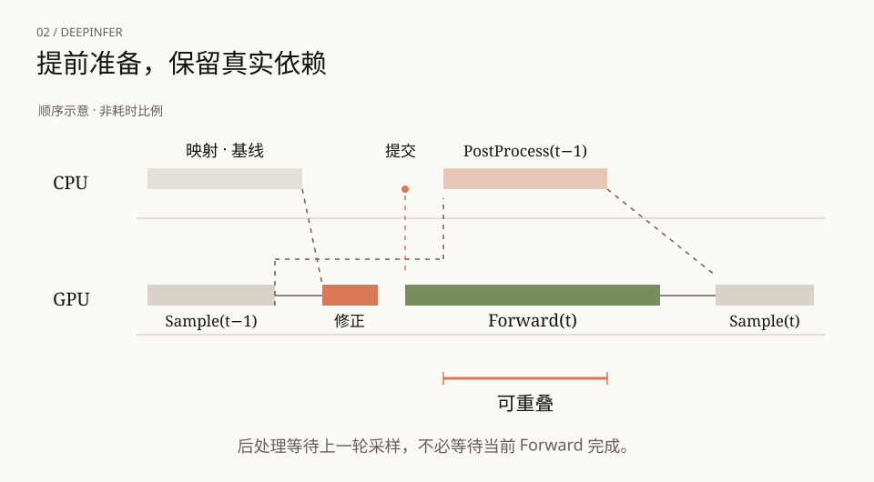
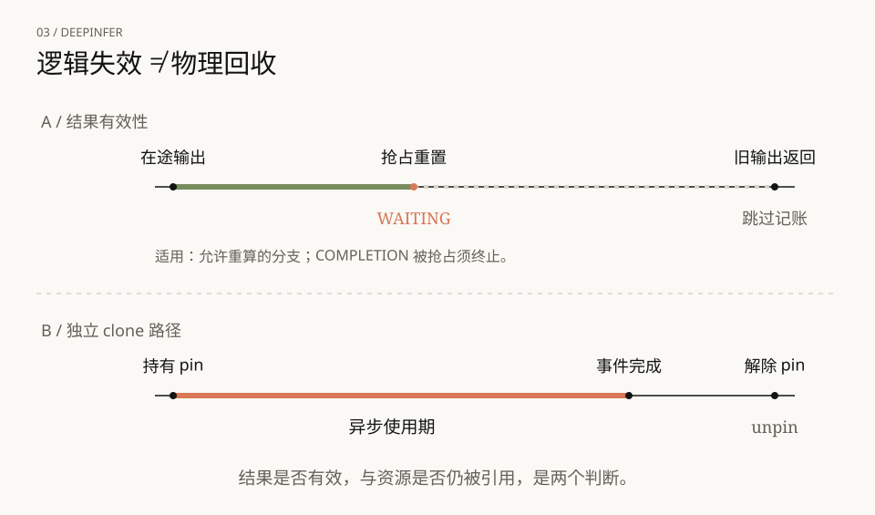

+++
title = '推理引擎的三本账：从 DeepInfer 看状态、时间与确定性'
date = 2026-11-15
draft = false
summary = '从 StateBlock、ZOS 与 DSpark 出发，理解推理引擎如何保存状态、隐藏等待，并区分数值正确性、批不变性与采样复现。'
tags = ['LLM 推理', 'DeepInfer', 'KV Cache', '推测解码']
showReadingTime = true
showTableOfContents = true
+++

> 本文面向了解 KV Cache、连续批处理和 GPU 异步执行的推理系统开发者。源码依据固定在 DeepInfer 的 [`a679bb86ce36e883a98a97733492b686e5b9a08e`](https://github.com/deepseek-ai/DeepInfer/tree/a679bb86ce36e883a98a97733492b686e5b9a08e)。生产部署信息单独引用仓库 Q&A，不把它等同于完整开源实现。本文是源码与设计分析，不包含 GPU 性能实测，也不承诺相关机制能直接迁移到其他框架。

阅读推理引擎时，很容易把注意力集中在最显眼的部分：注意力算子、低精度矩阵乘法、通信库，以及某种新的推测解码策略。它们当然重要，但仅仅列出这些组件，仍然解释不了一个请求为什么能更早完成。

算子之外，引擎还要决定哪些状态值得留下、下一轮何时可以准备、上一轮的输出何时可以处理。更微妙的是，调度策略改变之后，即使每个算子都正常工作，请求在不同批次中的生成行为也不一定获得相同的保证。

DeepInfer 提供了一个很好的观察对象。本文不试图介绍它的全部功能，而是围绕三本账展开：

- **状态账**：下一步需要哪些状态，谁保存，缺失后靠什么恢复？
- **时间账**：哪些工作可以提前，哪些必须等真实结果，资源何时才能复用？
- **确定性账**：改变批次组成或执行过程之后，究竟承诺哪些结果保持一致？

把三本账核对清楚，最后才有条件问：这项优化是否值得做？

## 一、算子之外，请求还在等什么？

先考虑一个教学请求 A。它已经完成输入处理，进入逐步生成 token 的 decode 阶段。引擎采用推测解码：先产生若干草稿 token，再由目标模型验证，决定接受多少。

最直观的执行方式是：GPU 完成本轮验证与采样，CPU 取得结果，更新请求状态，再准备下一轮输入。这个顺序很好理解，却把两类不同的事情绑在了一起。

一类确实依赖本轮结果。例如，接受了多少草稿，会影响下一轮的长度与位置。另一类却未必需要等待全部结果：请求身份、部分容量安排和元数据结构，可能已经能够准备。

如果必须等到所有信息确定，才开始做任何下一轮工作，那么真实依赖之外，还多出了一段由实现方式造成的等待。把某个 GPU kernel 加快，并不会自动消除这段等待。

DeepInfer 的 Worker 在 ZOS 路径下组织了本轮 Forward、上一轮 PostProcess、当前 Sample 等操作。重要的不是孤立记住这个调用顺序，而是看到：**主机处理结果的时机，不必与设备使用结果的时机完全绑定**。GPU 可以通过设备侧依赖消费已经产生的结果，而 CPU 不必先把每一项动态信息都取回来、处理完，才提交后续工作。[^1]

这里的目标是缩短关键路径——决定请求最早何时完成的依赖链，而不是单纯增加并发数量。一个算子即使快了，若它本来就在另一段更长的工作之后等待，最终收益也可能很小。

下文继续使用 A 作为教学身份，但各章是不同观察截面或明确标注的分支，不代表一次真实运行同时经历了所有机制，也不提供虚构的实测耗时。

## 二、状态账：哪些必须留下，哪些可以重建？

### 交接完整性，不等于长期保存范围

提到缓存，我们常把它想成一块统一的 KV：既然是后续计算要用的数据，就全部保存；既然某部分不保存，就认为它已经没有用了。

`StateBlock` 展示了另一种划分方式。它描述一个序列的 state cache 物理布局，分为前面的 stored region 和后面的 dropped region。前者包含需要持久复用的 SWA 状态；后者包含 YOCO consumer 层的 SWA，以及 compression state。SWA，即滑动窗口注意力，只关注受窗口约束的历史范围。[^2]

最容易误解的是 dropped 这个名字。它**不表示运行过程中随时可以丢弃**。源码注释明确写出：这部分状态运行时仍需保留，Prefill Engine 到 Completion Engine 的交接会传输两区；面向存储的导出则只取指定区域。

于是，同一个 A 可以有两种不同操作：

- **执行阶段交接**：接收方需要哪些状态，才能继续承担当前执行？
- **面向后续复用的导出**：哪些状态值得保存，其余部分满足什么恢复条件？

两者服务的目标不同，自然不必使用相同的范围。StateBlock 的注释还指出，consumer SWA 的恢复依赖 prefill 重算，compression state 没有跨落盘边界的依赖。这不是任意可删，而是模型结构和边界条件给出的具体依据。

*图 1：实线展示 StateBlock 的两种使用范围；虚线展示 Q&A 中的生产存储分工。两部分不是同一层抽象，图中刻意不把“存储导出”直接连接成“写 SSD”。*

### 存在哪里，与缺失后如何恢复，是另外两件事

生产 Q&A 描述了 Paged KV 与 SWA 的不同去向：前者进入专用 3FS 存储集群，后者留在产出机器的 Host 内存，通过目录定位和跨机传输供其他节点使用。[^3]

这也解释了为什么不能只看 `state_size_to_disk` 的变量名，就断言对应状态一定写进 SSD。接口命名、实际部署位置和恢复策略需要分别核对。

从这些设计中能提炼出的原则不是“某种缓存应该放 Host”，而是：**先明确状态的用途与恢复条件，再决定保存和传输策略**。某部分不在导出范围内，只回答了“没有保存什么”，并没有自动证明“缺失后能够无损恢复”。

> **边界框：YOCO 裁剪，不等于任意删除 KV。**
>
> DeepInfer 的 compact 路径会裁剪 query 行；相应 SWA 可见域要区分旧 state 与当前 chunk，同时受窗口、有效边界和回退量约束。保留长度至少需要覆盖窗口与最大回退长度，相关模式还有 prompt logprobs 的兼容限制。[^4] 这些条件体现了模型特定优化的约束，而不是一个对任意注意力模型成立的删除规则。
>
> 生产 Q&A 还将 bounded replay 描述为近似恢复。应把这种恢复精度声明与 compact 的具体裁剪机制分开说明，既不能把所有裁剪都称为“近似恢复”，也不能仅凭状态布局就声称恢复精确。

至此，状态账至少要记清三列：执行时需要什么、交接和导出分别携带什么、缺失后按什么条件恢复。接下来才轮到时间账：这些状态与元数据，何时必须准备好？

## 三、时间账：怎样提前准备，又不越过依赖？

### 第一拍：先找到同一个请求

假设上轮批次是 `[A, B]`，当前批次变成 `[B, C, A]`。B 和 A 延续，C 新加入。下标从零开始。

如果直接把“当前第零行”与“上轮第零行”关联起来，就会把 B 与 A 的历史结果混用。因此，跨轮复用首先面对的并不是数值计算，而是身份问题。

DeepInfer 根据序列身份建立映射。按“当前位置指向上轮位置”的方向，教学例子的 remap 为：

| 当前请求 | 当前位置 | 上轮位置 |
|---|---:|---:|
| B | 0 | 1 |
| C | 1 | -1 |
| A | 2 | 0 |

也就是 `[1, -1, 0]`。`-1` 表示没有上轮对应项，不表示 C 的全部状态都是零。remap 也不是一个搬运 KV 的指令；它首先告诉后续逻辑：**读取哪一个请求的上一轮结果**。[^5]

### 第二拍：再修正动态数值

找到身份以后，仍然要解决未知量。

例如，A 上轮验证两个草稿，只接受了第一个。下一轮准备期间，CPU 未必已经消费这个最终结果。如果把所有乐观预留都视为实际接受，长度就可能偏大；但如果因此让全部准备工作等待，又会失去重叠机会。

ZOS 将这件事拆成两部分：CPU 先构建可确定的映射和元数据基线；GPU 再依据上一轮仍驻留在设备上的真实结果，修正当前元数据。

在 `nextn > 0` 的相关路径中，C++ 准备阶段使用 `k−q` 形式的基线，设备侧结合当前 query 长度，并扣除上一轮拒绝的草稿所对应的增量。这里的关键是保留一套明确的计数约定，让乐观准备能够被实际结果校正，而不是假装 CPU 提前知道了接受数。[^5]

上面的“两草稿接受一个”只用于说明为什么需要修正，不直接替代源码字段的完整计数语义：草稿数、query 行数与实际推进 token 数，需要按各自定义区分。

*图 2：ZOS 的教学依赖图，不是 profiler 时间线。准备与上轮设备执行可以重叠；设备侧修正仍须等待所需的真实结果。提交当前 Forward 不等于等待它完成，上一轮后处理等待的是上一轮采样事件，可与当前 Forward 重叠。图中不表示所有工作无条件并发，也不承诺具体重叠时长。*

这样理解 ZOS，比记住“C++ 调度更快”更有迁移价值。C++ 可以减少一部分主机开销，但如果控制流程仍然规定每轮先等待 GPU、再准备下一轮，换语言并不会消除这条依赖链。

真正发生改变的是依赖的组织方式：**已知部分先做，未知部分交给能够及时获得结果的位置补齐**。但允许提前准备，并不允许提前消费尚未产生的数据；真实数据依赖仍需由设备执行顺序或其他同步机制保证。

而一旦下一轮已经开始准备，上一轮还在途中，状态的收尾就比串行执行更复杂了。

## 四、跨账核对：结果作废之后，谁还在使用资源？

### 输出无效，不等于设备已经停下

现在另开一个分支：A 在途时发生抢占。

在 NORMAL 引擎中，当配置允许抢占后重算、且没有结构化输出状态阻断重算时，A 可以重置后回到 WAITING。此时，上一轮输出可能尚未完成处理。如果它稍后返回，再按正常路径推进已经重置的缓存计数，就会把旧执行结果写进新的请求状态。[^6]

因此，源码对这类 WAITING 请求的在途旧输出进行跳过处理。这里解决的是**结果是否仍具有提交资格**，不是“输出有没有成功计算”。一个已经算出的结果，也可能因请求状态改变而不再应该记账。

与此同时，设备可能仍在引用某块内存。调度器把请求标成结束、取消或等待，并不能让已经提交的 GPU 工作凭空消失。资源能否回收，需要另一条证据：最后一个实际使用者是否结束。

### 抢占恢复能力取决于引擎模式

不能把上面的重算路径推广到所有引擎。DeepInfer 对 COMPLETION 模式设置了硬约束：必须启用抢占后终止请求的策略，不能假定该引擎拥有原地执行 prefill 重算的通道。[^6]

所以，对 A 的教学例子必须分清模式：

- NORMAL 且满足重算条件：可能重置并回到 WAITING，旧输出不得继续推进状态。
- COMPLETION：被抢占须终止，不能照搬上述重算分支。

“抢占后怎么办”不是一个统一答案，而由引擎职责、请求状态与恢复能力共同决定。

### 最后使用者需要单独追踪

DeepInfer 还包含延迟释放安排；在 clone 相关路径中，解除 pin 之前需要等待对应事件，确保实际拷贝完成。[^7] 这说明另一个独立原则：对象逻辑上已经不需要继续保留，不代表某个异步使用者已经完成。

这不是在说“所有抢占资源都由 clone 事件回收”。旧输出失效、延迟释放与 clone 事件保护，是不同位置承担的不同责任。把它们揉成一个笼统的“同步一下”，反而会遮住正确性边界。

*图 3：两个独立面板。上图在允许重算的条件下判断旧输出能否提交；下图判断 clone 资源何时可解除保护。两者不是同一次事件的连续步骤。*

生命周期因此不是第四本账，而是状态与时间的交叉核对：状态属于哪个版本，谁仍在使用，最后一次使用何时结束。

即使这些问题全部答对，也只证明不会错误地使用或回收状态。它仍然没有回答另一个问题：改变批次组成之后，A 是否一定产生相同输出？

## 五、确定性账：相同输入，究竟保证什么相同？

### “结果一致”需要先说清层次

性能优化的讨论里，经常出现一句含混的话：“已经固定种子，也用了确定性算子，所以输出应该一样。”这里至少混合了四种不同的保证。

| 保证 | 要回答的问题 |
|---|---|
| 数值正确性 | 结果是否符合参考语义及允许误差？ |
| 固定条件下的算子可复现性 | 相同条件重复计算，结果是否相同？ |
| 批不变性 | 同一请求放进不同组成的批次，指定模型结果是否保持一致？ |
| 采样输出可复现性 | 输入与采样参数固定后，是否得到相同生成序列？ |

一个程序可以稳定地产生错误结果，所以可复现不等于正确。一个算子也可以在固定 shape 下稳定，却在批次改变时选择不同的归约方式，因此固定条件复现不能自动推出批不变。

采样输出又比单步模型结果多了一层执行过程：每步验证哪些草稿、推进多少位置、后续使用什么输入，都可能受到运行配置影响。

### DSpark：预算与分配，不必使用同一时刻的信息

在推测解码中，多验证草稿不一定总是更划算。接受概率低的草稿会消耗验证工作量；增加 query 数也可能跨过某个 CUDA Graph 档位，使执行成本跳变。因此，预算需要结合预计收益与成本选择，而不是只追求验证更多 token。

DeepInfer 的相关调度在有性能曲线时，用较旧的接收率信息选择总 query 预算。在第 N 轮的相应路径中，CPU 使用 N−2 轮信息确定预算；ZOS 下，GPU 再用 N−1 轮更近的置信度，在预算内分配各请求的验证长度。[^8]

这并不表示系统不关心最新信息，而是把两个决策拆开了：总工作量先定，具体分配稍后确定。CPU 不必为了获得最新统计而把设备执行全部串行化。

这些结论有模式边界：非 ZOS 路径的相应分配在 CPU 侧完成；没有性能曲线时也存在回退。不能把 N−1 GPU 分配写成所有配置的统一行为。

### 共享预算让请求不再完全独立

现在比较两次教学运行：A 单独执行，以及 A 与 B 混批。保持 A 的输入和采样设置不变。

如果验证预算由整个批次共享，加入 B 后，A 面对的竞争条件就可能变化。即使某步 A 的模型结果没有变化，它得到的验证长度也可能不同。这解释了为什么“算子是确定的”不足以包办端到端采样复现：算子配置并没有完整规定调度轨迹。

但这里不能跨过逻辑边界：**预算变化不意味着最终文本每次都必然变化**。某些运行即使工作分配不同，也可能得到相同输出；一次相同输出也不能反过来证明任意混批条件下都成立。

最可靠的做法是遵守明确的配置契约，并验证所需要的输出对象。该版本 README 将 batch-invariant inference 与 deterministic sampling 分开列出：确定性采样要求开启批不变推理、关闭 MTP_VARLEN，并为请求提供固定 `seq_seed`；相关功能标注为 NVIDIA 路径。[^9]

因此，吞吐优化与确定性要求应该分别验收。问题不是“动态调度好不好”，而是：在当前业务要求下，哪些变化允许发生，哪些结果必须保持一致？

## 六、总核算：这项优化，现在值得验证吗？

三本账并不是为了给每种技术归类，而是为了把一个模糊的优化想法变成可以检查的判断过程。

以“提前准备下一轮”为例，可以依次过五关。

### 第一关：到底改变了什么？

是删掉一部分状态，改变数据存放位置，提前准备元数据，还是调整每个请求的验证预算？如果不能准确指出变化对象，就很难判断收益来自哪里，也很难设计反例。

“用了 C++”“引入异步”“启用 Graph”都是实现描述，还不是完整的机制解释。

### 第二关：是否保持原来的语义？

如果省掉状态，需要说明为什么不再需要它，或如何恢复。若引入近似恢复，就应另设质量门禁，不能继续拿精确结果一致作为未经验证的前提。

ZOS 的元数据修正、YOCO 的模型特定裁剪、生产 bounded replay 的近似恢复，应分别建立自己的证据，不因它们都涉及“少做一些工作”而混用结论。

### 第三关：异常路径还能正确执行吗？

检查批次重排、新请求进入、草稿全部被拒绝、取消与抢占。请求身份是否仍对应正确？旧结果是否会写入新状态？容量预留是否足够？最后使用者是否已经结束？

正常路径跑通，只说明正常路径跑通。诊断工具没有报告同步错误，也不能替代完整的生命周期检查。

### 第四关：要求保持哪种一致性？

明确需要数值对齐、固定条件复现、跨批次结果一致，还是最终生成序列复现。分别准备对应测试，而不是用一次固定种子运行代替全部保证。

如果性能策略与某种一致性契约存在约束关系，需要显式选择配置，不应让用户在不知情的情况下承担变化。

### 第五关：净收益是否落在关键路径上？

假设 CPU 准备已经完全被 GPU 计算覆盖，在没有其他资源影响的条件下，继续缩短这段准备未必缩短请求完成时间。只有仍然暴露在关键路径上的部分，才有直接降低延迟的空间。

反过来，提前准备也可能新增管理、内存或争用成本。端到端比较需要冻结硬件、模型、输入与并行配置，并计入实际承担的准备、捕获等成本。生产基线如果已经开启 CUDA Graph，就不能只用关闭 Graph 的微基准宣称上线收益。

时间线帮助解释为什么变快，完整请求指标才回答用户是否真的更早拿到结果。吞吐、首 token 延迟和后续 token 间隔也需要分别观察，不能互相代替。

对于尚未验证的方案，结论应清楚地停在“值得验证”“前提未满足”或“证据不足”，而不是跳到迁移承诺。

回到开头，DeepInfer 最值得带走的并不是某份实现清单，而是一种组织问题的方法：

**先说明状态为什么存在，再说明工作何时能做，最后说明执行变化仍保持哪些保证。只有这些都明确，性能数字才有完整的含义。**

---

## 附录：实现边界与阅读入口

### A. 正文刻意没有展开的细节

- **StateBlock**：具体字节布局、对齐、ring 重排和层配置依赖，参见源码注释与初始化逻辑；不应从示意图推导通用布局。
- **YOCO**：compact 的 query 行裁剪、窗口与回退约束、有效范围及 prompt logprobs 限制，需要结合模型与配置阅读，不是通用 KV 剪枝法。
- **DSpark**：性能曲线、Graph 档位、非 ZOS 路径和无曲线回退，不能只保留 N−2/N−1 这一句口号。
- **抢占**：`stop_preempted_request` 和结构化输出状态会影响是否能重算；COMPLETION 的限制不是可省略的性能选项。

本文没有展开 Engram、PDL 或各算子库，也没有审计 SGLang / vLLM-Omni 的对应实现；相关名称出现与否，不代表目标框架存在或缺少某项能力。

### B. 确定性配置

该版本 README 对确定性采样给出的条件为：

- `DEEPINFER_BATCH_INVARIANT=1`；
- `DEEPINFER_ENABLE_MTP_VARLEN=0`；
- `SamplingParams` 使用固定 `seq_seed`；
- 适用范围标为 NVIDIA。

这些是所引用版本的使用契约，不应默认为任意未来版本或后端都相同。

### C. 固定版本源码引用

以下链接均固定至同一提交，不随 main 分支变化。

[^1]: [Worker 的执行与后处理顺序](https://github.com/deepseek-ai/DeepInfer/blob/a679bb86ce36e883a98a97733492b686e5b9a08e/deepinfer/worker/worker.py#L94-L184)。
[^2]: [StateBlock 布局、交接与导出范围](https://github.com/deepseek-ai/DeepInfer/blob/a679bb86ce36e883a98a97733492b686e5b9a08e/deepinfer/worker/cache_engine.py#L221-L307)。
[^3]: 生产部署 Q&A：[Paged KV 与专用 3FS](https://github.com/deepseek-ai/DeepInfer/blob/a679bb86ce36e883a98a97733492b686e5b9a08e/doc/inference_deployment_qa.md#L163-L175)、[SWA 存储与恢复](https://github.com/deepseek-ai/DeepInfer/blob/a679bb86ce36e883a98a97733492b686e5b9a08e/doc/inference_deployment_qa.md#L217-L245)。仅作为部署描述引用，不代表本文复现了该生产环境。
[^4]: [YOCO 元数据处理](https://github.com/deepseek-ai/DeepInfer/blob/a679bb86ce36e883a98a97733492b686e5b9a08e/csrc/engine/input_metadata/prepare_tensor_input_v4.cpp#L149-L225)、[启动约束](https://github.com/deepseek-ai/DeepInfer/blob/a679bb86ce36e883a98a97733492b686e5b9a08e/deepinfer/worker/model_runner.py#L106-L113)、[prompt logprobs 限制](https://github.com/deepseek-ai/DeepInfer/blob/a679bb86ce36e883a98a97733492b686e5b9a08e/deepinfer/engine/llm_engine.py#L529-L537)。
[^5]: [ZOS C++ 元数据准备](https://github.com/deepseek-ai/DeepInfer/blob/a679bb86ce36e883a98a97733492b686e5b9a08e/csrc/engine/zos.cpp#L142-L226)、[Worker GPU 修正路径](https://github.com/deepseek-ai/DeepInfer/blob/a679bb86ce36e883a98a97733492b686e5b9a08e/deepinfer/worker/worker.py#L192-L246)、[设备侧长度修正](https://github.com/deepseek-ai/DeepInfer/blob/a679bb86ce36e883a98a97733492b686e5b9a08e/deepinfer/model_executor/layers/tilelang_ops/cuda/compute_seqlens_k_zos.py#L22-L36)。
[^6]: [COMPLETION 构造约束](https://github.com/deepseek-ai/DeepInfer/blob/a679bb86ce36e883a98a97733492b686e5b9a08e/csrc/engine/scheduler.hpp#L102-L104)、[抢占分支](https://github.com/deepseek-ai/DeepInfer/blob/a679bb86ce36e883a98a97733492b686e5b9a08e/csrc/engine/scheduler.hpp#L766-L789)、[WAITING 输出处理](https://github.com/deepseek-ai/DeepInfer/blob/a679bb86ce36e883a98a97733492b686e5b9a08e/csrc/engine/scheduler.hpp#L917-L927)。
[^7]: [DeferredRelease 与相关事件等待](https://github.com/deepseek-ai/DeepInfer/blob/a679bb86ce36e883a98a97733492b686e5b9a08e/deepinfer/engine/llm_engine.py#L67-L119)。
[^8]: [MTP varlen 预算选择](https://github.com/deepseek-ai/DeepInfer/blob/a679bb86ce36e883a98a97733492b686e5b9a08e/csrc/engine/mtp_varlen.hpp#L150-L226)、[Worker 分配路径](https://github.com/deepseek-ai/DeepInfer/blob/a679bb86ce36e883a98a97733492b686e5b9a08e/deepinfer/worker/worker.py#L218-L231)。
[^9]: [README 的 batch-invariant 与 deterministic sampling 契约](https://github.com/deepseek-ai/DeepInfer/blob/a679bb86ce36e883a98a97733492b686e5b9a08e/README.md#L21-L29)。
