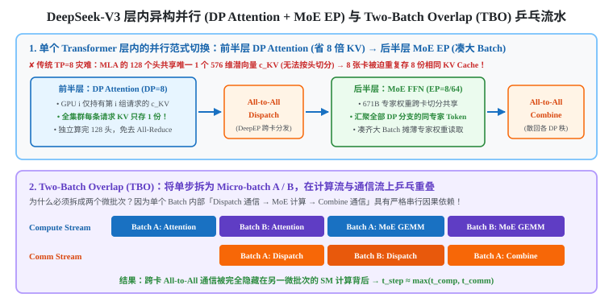
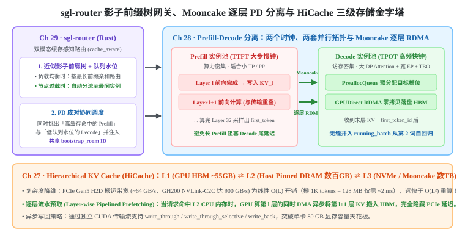

+++
title = 'SGLang 架构精读（三）：DP Attention、Two-Batch Overlap、HiCache 与 Mooncake PD 分离全景'
date = 2026-11-03
draft = false
summary = '结合 SGLang 核心源码完整补齐《Learning SGLang》Part IV–V 进阶与多卡解耦架构（Ch 22–29）：涵盖 W4A16 与 W8A8 (FP8) 量化的 Roofline 改写算术、MLA 遇上传统 TP 的 8 倍 KV 冗余灾难与 DP Attention + MoE EP 解耦破局、Two-Batch Overlap (TBO) 双微批计算/通信双流乒乓隐藏、HiCache 三级存储金字塔逐层流水预取、Mooncake GPUDirect RDMA 逐层零拷贝 PD 分离，以及 sgl-router 影子前缀树动态负载均衡。'
tags = ['SGLang', 'LLM 推理', 'DP Attention', 'MoE', 'PD 分离', 'Mooncake', 'HiCache']
showReadingTime = true
showTableOfContents = true
+++



> 本文基于 Wilson Zheng 的交互式开源教程 **[Learning SGLang](https://wilsonzheng0327.github.io/learning-sglang/)** 的 Part IV–V 章节蓝图（Ch 22–29）与 SGLang 生产级源码（`dp_attention.py`、`two_batch_overlap.py`、`hiradix_cache.py`、`disaggregation/` 及 `sgl-router`）深度补全整理，为「SGLang 架构精读」三部曲之收官篇。
> - **第一篇**：[从三级页表、Piecewise CUDA Graph 到 MLA 矩阵吸收与投机解码（Ch 01–15）](/notes/llm-inference/sglang-single-gpu-engine/)
> - **第二篇**：[SGLang-Omni 七阶段异构调度、流式硬实时声码器与原生全双工状态机（Ch 16–21）](/notes/llm-inference/sglang-omni-full-duplex/)
> - **第三篇（本文）**：DP Attention、Two-Batch Overlap、HiCache 与 Mooncake PD 分离全景（Ch 22–29）

在[第一篇](/notes/llm-inference/sglang-single-gpu-engine/)中，我们把单张 H100 上的 CPU 启动开销（$t_{\text{cpu}}$）压到了 $1.2\,\text{ms}$，并通过 MLA 矩阵吸收与投机解码榨干了单卡性能。但当我们面对生产环境的终极挑战——例如服务 **[DeepSeek-V3](https://arxiv.org/abs/2412.19437)（$671\text{B}$ 总参数、每 token 激活 $37\text{B}$、MLA + $256$ 路由专家 MoE）** 或支撑百万级长上下文并发时，我们会迎头撞上四堵物理高墙：

1. **单步权重读取底噪墙（Ch 22）**：即便算子零开销，每步流式读取全量权重的 $t_{\text{mem}}$ 依然卡死在硬件带宽上限；
2. **多卡并行与跨卡通信墙（Ch 23–26）**：模型装不进单卡，但对 MLA 硬上传统张量并行（TP）会导致灾难性的 **KV Cache 重复存储**，而专家并行（EP）的 `All-to-All` 通信又会让 GPU 算力陷入漫长等待；
3. **单机 HBM 容量墙（Ch 27）**：单卡 $80\,\text{GB}$ HBM 扣掉权重后仅剩几十 GB，海量多轮 Agent 会话的 `RadixCache` 频繁被 LRU 驱逐重算；
4. **Prefill 与 Decode 的双时钟冲突墙（Ch 28–29）**：吞吐导向的长 Prefill 与延迟敏感的 Decode 混跑在同一张卡上相互拖累，且多实例集群下的网关路由面临「保缓存命中率」还是「保负载均衡」的两难悖论。

本篇将结合 SGLang 核心源码，逐一拆解这八章（Ch 22–29）的系统级解法。

---

## 一、More from One GPU：量化算术与双微批重叠（Ch 22–23）

### 1. 量化（Quantization）：如何改写 Roofline 方程的两端？（Ch 22）

回到我们在第一篇建立的单步耗时方程：

$$t_{\text{compute}}(n) = \frac{2Pn}{\text{FLOP/s}}, \qquad t_{\text{memory}}(n) = \frac{2P + \text{KV Cache}}{\text{bytes/s}}$$

在 Llama-3-8B（bf16）下，每步雷打不动要读 $16\,\text{GB}$ 权重（底噪 $t_{\text{mem}} \approx 4.8\,\text{ms}$）以及每 token $128\,\text{KB}$ 的 KV Cache。工程实践中主流的两类量化方案，分别改写了上面方程中的不同项：

| 量化范式 | 代表算法与硬件路径 | 权重底噪 $t_{\text{mem}}$ (8B) | 峰值算力 (H100) | Roofline 平衡点 $n^*$ 变化与适用工况 |
|---|---|---|---|---|
| **bf16 基线 (W16A16)** | 标准 bf16 Tensor Core | $16\,\text{GB} \Rightarrow \mathbf{4.8\,\text{ms}}$ | $989\,\text{TFLOP/s}$ | $n^* \approx 295\sim 560$ tokens |
| **仅权重量化 (W4A16)** | [AWQ](https://arxiv.org/abs/2306.00978) / GPTQ / Marlin 内核 | $4\,\text{GB} \Rightarrow \mathbf{1.2\,\text{ms}}$（降 4 倍） | 仍为 $989\,\text{TFLOP/s}$（算前在寄存器反量化为 bf16） | **专治小 Batch Decode**：访存底噪砍掉 $75\%$，但平衡点 $n^*$ 左移至 $\sim 140$；大 Batch Prefill 下因反量化开销且无算力加成，速度甚至略慢于 bf16 |
| **权重激活双量化 (W8A8 + KV8)** | [SmoothQuant](https://arxiv.org/abs/2211.10438) / Hopper FP8 Tensor Core | $8\,\text{GB} \Rightarrow \mathbf{2.4\,\text{ms}}$（降 2 倍，KV 亦降至 $64\,\text{KB/tok}$） | **$1,979\,\text{TFLOP/s}$**（FP8 Tensor Core 翻倍） | **Prefill 与 Decode 双杀**：分子分母同步缩放 2 倍，平衡点 $n^*$ 保持不变，全区间耗时减半 |

---

### 2. Two-Batch Overlap（TBO）：为什么必须拆成两个微批次才能隐藏通信？（Ch 23）

当模型跨越多张 GPU（特别是引入下一节将讲到的 MoE 专家并行 EP）时，每一层 Transformer 内部都会插入沉重的跨卡集合通信：`All-to-All Dispatch`（将 token 发往对应专家所在的 GPU）与 `All-to-All Combine`（将专家算完的结果收回原 GPU）。

在默认单批次执行下，单步耗时退化为串行相加：$t_{\text{step}} = t_{\text{comp}} + t_{\text{comm}}$。
为什么 GPU 不能在算当前层 MoE 矩阵乘的同时，顺手把当前层的 `All-to-All` 通信也干了？
- **因为同一个 Batch 内部存在严格的因果数据依赖（Causal Data Dependency）**：你必须先通过 `All-to-All Dispatch` 把 token 的隐状态从网卡/NVLink 收下来，SM 张量核心才有数据去算 `MoE GEMM`；必须等 `MoE GEMM` 算完，才能做 `All-to-All Combine`！对着同一个 Batch，计算流（Compute Stream）和通信流（Comm Stream）只能大眼瞪小眼地排队交替干活。

SGLang 的 **`two_batch_overlap.py`（`--enable-two-batch-overlap`）** 用极为优雅的「微批分身术」破除了这一死锁：
1. 在进入模型前，调度器将当前 step 的请求批次一刀切分为两个规模相当、**彼此完全没有数据依赖**的子批次：**Micro-batch A** 与 **Micro-batch B**；
2. 在 GPU 上同时开辟两条硬件流（**Compute Stream** 跑 Tensor Core 算子，**Comm Stream** 跑 DeepEP / NCCL 通信内核）进行乒乓交错（Ping-Pong Pipelining）：
   - 当 **Compute Stream** 正在全力计算 **Micro-batch B** 的 Attention，或计算 **Micro-batch A** 的 MoE 专家 GEMM 时；
   - **Comm Stream** 同时在后台满带宽传输 **Micro-batch A** 的 `All-to-All Dispatch`，或传输 **Micro-batch B** 的 `Dispatch`！
3. 通过让 A 的计算掩盖 B 的通信、B 的计算掩盖 A 的通信，跨卡通信延迟从加法项变成了取大项：

$$t_{\text{step, TBO}} \approx \max\!\big(t_{\text{comp}},\; t_{\text{comm}}\big)$$

---

## 二、More than One GPU（上）：TP、EP 与 DP Attention 异构解耦（Ch 24–26）

### 1. 经典 TP 的通信瓶颈与 PP/EP 的分工（Ch 24–25）

当模型大到单卡放不下时，最基础的切分方式有三种：
- **张量并行（Tensor Parallelism, TP，Ch 24）**：按列/行切分每层的权重矩阵（如 QKV 投影按头切分，$O$ 投影与 MLP 下投影做行切分），每层需要执行 **2 次跨卡 `All-Reduce`**（Attention 后一次、MLP 后一次）。设并行度为 $p$，单步延迟为 $t_{\text{TP}} = \frac{t_{\text{comp}}}{p} + t_{\text{comm}}$。在小 Batch Decode 阶段，$t_{\text{comp}}$ 极小而每次 `All-Reduce` 的启动与同步延迟固定，盲目增大 TP 度会导致通信占比反超计算收益，因此 **TP 通常严格限制在单机 NVLink 域内（$p \le 8$）**。
- **流水线并行（Pipeline Parallelism, PP，Ch 25）**：按层（Layers）纵向切分到不同节点，节点间仅传递一层边界的激活张量（通信量极小，适合跨机慢速网络），但需要多微批流水填充气泡。
- **专家并行（Expert Parallelism, EP，Ch 25）**：专为稀疏 MoE 模型（如 DeepSeek-V3 每层 256 个路由专家，每 token 仅激活 8 个）设计。不同 GPU 持有不同的专家权重子集，前向时通过 `All-to-All` 将 token 路由到目标专家所在 GPU 计算。

---

### 2. 为什么 MLA 遇上传统 TP 会发生“8 倍 KV 冗余灾难”？（Ch 26：DP Attention）

现在我们来到多卡篇最核心的架构转折点：**在 8 卡（或 64 卡）上服务 DeepSeek-V3 时，为什么绝对不能对整层直接用传统的 `TP=8`，而是必须在同一个 Transformer 层内部，前半截 Attention 用数据并行（`DP Attention`，`--enable-dp-attention`），后半截 MoE FFN 却瞬间切换成跨卡专家并行（`EP`）？**

很多人第一反应是“为了省掉 Attention 后的那次 All-Reduce 通信”。这只是次要收益，**真正致命的原因藏在 MLA 的 KV Cache 结构里**：

1. **传统 TP=8 在 MLA 上的「8 倍显存与带宽浪费」**：
   - 在传统 MHA（例如 64 个 KV 头）中，开 `TP=8` 时每张 GPU 恰好分担 $64 / 8 = 8$ 个 KV 头，8 张卡合起来正好存 1 份完整的 KV Cache，没有任何冗余。
   - 但在[第一篇 Ch 14](/notes/llm-inference/sglang-single-gpu-engine/) 我们学过：**DeepSeek-V3 的 MLA 将全部 128 个 Query 头的键值压缩成了唯一 1 个共享的 576 维潜向量 $\mathbf{c}_{KV}$（等效 KV 头数 $= 1$）！**
   - 如果你对 MLA 的 Attention 硬开 **`TP=8`**（每张卡切分 $128 / 8 = 16$ 个 Query 头）：由于那**唯一 1 个共享的 $\mathbf{c}_{KV}$ 根本无法再按头切分成 8 瓣**，每张卡上的 16 个 Query 头都必须读取完整的 $\mathbf{c}_{KV}$！
   - **灾难后果**：**8 张 GPU 被迫在各自的 HBM 里重复存储一模一样的 8 份 $\mathbf{c}_{KV}$，并在每个 Decode step 重复从 HBM 读取 8 遍！** 单机可用 KV Cache 容量直接缩水为原来的 **$1/8$**！

2. **为什么后半截 MoE 层又不能继续各跑各的 `DP=8`？**
   既然 Attention 用数据并行这么好，为什么不干脆整台机器跑 8 个完全独立的 `DP=8` 实例？
   - **第一，权重装不下**：DeepSeek-V3 总参数量高达 $671\text{B}$，单张 GPU 根本塞不下全部 256 个专家的权重，必须跨 8 张甚至 64 张卡切分专家（EP）。
   - **第二，稀疏专家凑不够 Batch Size**：在 Decode 阶段，假设每个 DP 分支只有 16 个请求（16 个 token），平摊到 256 个专家上，几乎每个被激活的专家只分到 1 个 token，读取庞大专家权重的带宽完全无法摊薄！而 **FFN 层在数学上是逐 Token 独立运算（Token-wise Independent），根本没有跨位置的因果依赖，也不需要访问任何 KV Cache**！

3. **SGLang 的层内异构解耦架构（`dp_attention.py`：Replicate Attention, Share the Rest）**：
   看清了这两头的物理本质，SGLang 的设计就顺理成章了（见上图上半部分）：
   - **前半层（Attention 侧跑 `DP=8`）**：将全局批次按请求拆成 8 份，每张 GPU 只存自己那 $1/8$ 请求的 $\mathbf{c}_{KV}$ 缓存，并独立算完这批请求的全部 128 个 Query 头——**全集群每条请求的 KV Cache 只存唯一 1 份（可用容量暴涨 8 倍）**，且 Attention 后无需跨卡同步！
   - **层中切换（`All-to-All Dispatch` / `All-Gather`）**：一出 Attention，立即将 8 张（或 64 张）卡上的所有 token 汇集起来，按 MoE 门控路由分发给持有对应专家权重的 GPU；
   - **后半层（MoE 侧跑 `EP=8/64`）**：每个专家汇聚了来自全集群所有 DP 分支的同路由 token，瞬间凑齐大 Batch 打满 Tensor Core 算力！算完后再经 `All-to-All Combine`（或 `Reduce-Scatter`）精准散回原先的 DP Attention 分支。

---

## 三、More than One GPU（下）：HiCache、PD 分离与全局路由（Ch 27–29）

### 1. Hierarchical KV Cache（`HiCache`）：L1/L2/L3 金字塔与逐层流水预取（Ch 27）

即便用上了 `DP Attention`，单张 H100 的 L1 HBM 池（$\sim 55\,\text{GB}$）在面对海量多轮 Agent、长文档问答或全天高频复用的提示词树时依然捉襟见肘。与此同时，GPU 服务器主机上却闲置着 **$512\,\text{GB}\sim 2\,\text{TB}$ 的廉价 CPU 内存（Host DRAM）** 以及数 TB 的本地 NVMe SSD 与远端分布式存储。

SGLang 的 **`HiRadixCache`（`--enable-hierarchical-cache`，`mem_cache/hiradix_cache.py`）** 将单层 GPU `RadixCache` 扩展为三级存储金字塔：

- **三级存储层次**：
  - **L1（GPU HBM，$\sim 55\,\text{GB}$）**：当前活跃与最热前缀页；
  - **L2（Host Pinned DRAM，数百 GB 至 TB）**：通过 PCIe Gen5（双向带宽 $\sim 64\,\text{GB/s}$）或 Grace Hopper NVLink-C2C（高达 $900\,\text{GB/s}$）直连的锁页主机内存池（`HostKVCache`）；
  - **L3（外部存储，数 TB 至 PB）**：通过 `HiCacheStorage` 插件对接本地 NVMe、Mooncake Store 或 3FS。
- **为什么从 CPU 搬运 KV 比 GPU 重算快得多？（$O(L)$ vs $O(L^2)$）**：
  对于 Llama-3-8B，1,000 个 token 的 KV Cache 体积为 $128\,\text{MB}$，通过 PCIe Gen5 从 CPU 内存搬回 GPU HBM 仅需 **$\sim 2\,\text{ms}$**，且搬运耗时随长度呈**严格线性 $O(L)$** 增长；而重新执行长序列 Prefill 的注意力计算量呈 **$O(L^2)$ 二次方爆炸**！
- **逐层流水预取（Layer-wise Pipelined Prefetching）**：
  为了不让这 $\sim 2\,\text{ms}$ 的 PCIe 搬运阻塞主计算流，当新请求在 L2（CPU 内存）命中长前缀时，`HiCacheController` 在独立 CUDA DMA 传输流上启动**逐层流水预取**——**当 GPU 的 Compute Stream 正在计算第 $l$ 层的前向时，DMA Transfer Stream 同时把第 $l+1$ 层命中的 KV 页面从 Host DRAM 异步拷入 GPU HBM**，将跨总线搬运延迟完全藏进计算背后！

---

### 2. Prefill-Decode 分离（PD Disaggregation）：两个时钟，两套机器（Ch 28）

在[第一篇 Ch 06](/notes/llm-inference/sglang-single-gpu-engine/) 我们学过单机内的 `Chunked Prefill` 与 `Mixed Chunk`。既然单机已经能把 Prefill 切碎混入 Decode 步了，**为什么在大规模生产集群中，SGLang 还要用 `--disaggregation-mode prefill|decode` 把机器彻底拆成「专跑 Prefill 的实例池」与「专跑 Decode 的实例池」？**

因为单机混合调度在物理上存在**两大不可调和的矛盾**：

1. **矛盾一：两个水火不容的时钟（Two Clocks — TTFT vs TPOT）**：
   - **Prefill 时钟** 是吞吐优先的大步慢钟（Compute-bound，单步跑数千 token 以打满算力，耗时 $50\sim 200\,\text{ms}$），优化目标是首字延迟 **TTFT**；
   - **Decode 时钟** 是延迟优先的高频快钟（Memory-bandwidth bound，单步必须严控在 **$\le 10\sim 20\,\text{ms}$**），优化目标是每个生成词的间隔延迟 **TPOT**。
   - 如果把两者混在同一台机器上，哪怕混入一个中等大小的 Prefill chunk，当前 step 的耗时也会瞬间膨胀数倍，导致同批次正在流式吐字的成百上千个 Decode 用户同时遭遇卡顿毛刺！
2. **矛盾二：Prefill 与 Decode 的最优并行拓扑截然相反**：
   - **Prefill 节点**：单条请求自带数千个 token，无需凑大并发就能打满 Tensor Core 和 MoE 专家，因此最适合 **小 TP / PP（如 `TP=4/8`）**，既不需要跨几十张卡做大 EP，也不需要庞大的 KV 显存池；
   - **Decode 节点**：每条请求每步只有 $1$ 个 token，必须靠成百上千条高并发请求才能摊薄 671B MoE 权重的读取带宽，因此最适合 **大 `DP Attention` + 超宽专家并行（如 `EP=64/128`）+ `TBO`**！

#### Mooncake 零拷贝逐层 RDMA 移交机制（算一层、传一层）

把 Prefill 和 Decode 拆到两台机器后，如何把 Prefill 算出的数 GB KV Cache 传给 Decode 节点而不增加 TTFT 等待？SGLang（`srt/disaggregation/`）设计了精妙的三步零拷贝流水：
1. **Bootstrap 预分配握手**：请求开跑前，Decode 节点先在 `DecodePreallocQueue` 中预留好目标物理 KV 槽位，并通过 `BootstrapServer` 将目标显存的 **RDMA 远端内存描述符** 发送给 Prefill 节点。
2. **逐层异步 GPUDirect RDMA 传输**：Prefill 节点**绝不等 32 层全部算完才开始传**！它每算完第 $l$ 层 Attention 写入本地 KV 池，后台的 **Mooncake / NIXL Transfer Engine** 立即通过网卡发起 **GPUDirect RDMA Write**，将第 $l$ 层的 KV 页面直接零拷贝写入 Decode 节点的 GPU HBM——**第 $l$ 层的跨机网络传输与第 $l+1$ 层的 GPU 前向计算完全并行重叠**！
3. **首词无缝交棒**：当 Prefill 节点算完最后一层并采样出第 1 个生成词（`first_token_id`）时，前 $L-1$ 层的 KV Cache 早已躺在 Decode 节点的显存里了！Decode 节点收齐末层 KV 与 `first_token_id`，立即从 `TransferQueue` 并入 `running_batch`，从第 2 个词起高频自回归。

---

### 3. The Router（`sgl-router`）：影子前缀树化解「缓存亲和 vs 负载均衡」悖论（Ch 29）

当集群扩缩容至 $M$ 台独立的 SGLang 引擎实例时，挡在最前面的网关路由器面临一个经典的分布式两难：
- **若采用传统 `Round-Robin`（轮询）或随机路由**：同一个用户的多轮对话、或共享同一段万字 System Prompt 的请求被均匀打散到 $M$ 台机器上——每台机器的 **`RadixCache` 命中率瞬间暴跌至 $1/M$**，且 $M$ 台机器的显存里重复存满相同的系统提示词！
- **若采用死板的「按 Prompt 前缀静态哈希」**：一旦线上涌入 1,000 条带有相同热门 System Prompt 的并发请求，哈希函数会把这 1,000 条请求**全部死死打向同一台机器（Worker 0）**，导致 Worker 0 队列塞爆返回 503，而其余 $M-1$ 台机器完全闲置！

SGLang 用 Rust 编写的高性能网关 **`sgl-router`（`cache_aware` 策略）** 通过在网关层维护**「近似影子前缀树（Approximate Shadow RadixTree）+ 实时队列水位监控」**完美消解了这一悖论：
1. **负载均衡期（最大最小队列水位差 $\le$ 阈值）$\rightarrow$ 缓存亲和路由**：
   Router 在自己内存中的影子前缀树上匹配当前请求的 Token 序列，将其精准路由至**已缓存最长公共前缀**的那台 Worker，使集群级 `RadixCache` 命中率逼近单机理想上限；
2. **热点过载期（目标节点负载超出不均衡阈值）$\rightarrow$ 负载均衡分流**：
   一旦持有热门前缀的 Worker 队列水位超标，Router 自动切换为最短队列优先，将溢出的同前缀请求分流至当前最空闲的 Worker，并在影子树中为该空闲节点登记这棵热门前缀的第二份缓存副本，实现热点自动扩散；
3. **PD 分离协同编排**：
   在 PD 分离架构下，`sgl-router` 作为统一前门，对每条到达的请求**同时用影子前缀树挑出缓存命中率最高的 Prefill 节点、用负载水位挑出最空闲的 Decode 节点**，生成配对的 `bootstrap_room` ID 同时下发给两端，完成全集群的闭环调度。

---

## 四、全书大结局：Learning SGLang 29 章问题与解法全景总表

至此，我们已经走完了从第 1 章（最简自回归循环）到第 29 章（分布式集群网关）的全部旅程。下表将全书 29 章浓缩为一份可随时查阅的架构索引：

| 章节区间 | 核心痛点问题 | 物理瓶颈项 | SGLang 核心架构解法与源码锚点 |
|---|---|---|---|
| **Ch 01–04** | 自回归每步重复计算历史序列；Prompt 与生成阶段硬件特征迥异 | $O(L^2)$ 算力浪费；Prefill 算力受限 vs Decode 带宽受限 ($4.8\,\text{ms}$ 底噪) | **KV Cache**（仅存 K/V 丢弃 Q，Llama-3-8B 为 $128\,\text{KB/tok}$）；`lm_head` 仅在 Prompt 末位执行 |
| **Ch 05–06** | 静态批处理填充气泡大；长 Prompt Prefill 冻结同批 Decode 请求 | GPU 空转气泡与 TPOT 长尾毛刺 | **Continuous Batching**；`--prefill-decode-interval` 步进交错与 `--enable-mixed-chunk`（$c \le n^*-B$） |
| **Ch 07–08** | 预留最大长度造成 $>60\%$ 显存碎片；多轮对话与共享前缀重复 Prefill | HBM 容量墙与重复计算 | **`page_size=1` 三级显存池**（`ReqToTokenPool` / `MHATokenToKVPool`）；`PrefillAdder` 动态衰减预留与 `retract_decode`；**`RadixCache`** 前缀压缩树与叶子 LRU 淘汰 |
| **Ch 09–10** | 千级 HTTP 连接与分词阻塞 GPU 循环；串行调度存在 CPU 等待气泡 | $t_{\text{cpu}}$ 调度延迟与进程 GIL 争用 | **三进程 ZeroMQ IPC 单向环**；**`Overlap Scheduling`**（页表分配与具体词解耦，`future_token_ids_map` 显存直传） |
| **Ch 11–13** | 小 Batch Decode 与 $n<560$ 短 Prefill 受限于 $\sim 1000$ 次算子启动 ($9.0\,\text{ms}$) | **CPU Launch-bound** ($9.0\,\text{ms} > 4.8\,\text{ms}$) 与逐元素算子 HBM 往返 | **`CudaGraphRunner`**（Decode 整图 + 静态缓冲区就地覆写）；**`PiecewiseCudaGraphRunner`**（Dynamo 在 Attention 处拆为 33 段静态图，压至 $1.2\,\text{ms} < 4.8\,\text{ms}$）+ **Inductor** SwiGLU 融合 |
| **Ch 14–15** | Decode Attention 算术强度仅 $1\sim 4\,\text{FLOP/byte}$；小 Batch 下算力大量闲置 | HBM 带宽抽水机；单步仅产出 1 词 | **5 大 Attention Backend**（CSR 页表 + 图内外 `plan()` 拆分，Hopper 默认 `fa3`）；**MLA 矩阵吸收**（拉升至 $128\,\text{FLOP/byte}$）；**EAGLE-3 / DFlash / DSpark** 投机解码 |
| **Ch 16–19** | 多模态语音需 $80\,\text{ms}$ 帧生成 16 个 RVQ 码；多模型共卡爆显存且争抢 SM | 异构计算图、$85.7\,\text{GB}$ 显存墙与 Talker $86\%$ SM 争用（TTFA p90 翻倍） | **SGLang-Omni 七阶段三类调度器**（Code Predictor 内嵌单步，Talker 关闭 Radix 与 Overlap）；**`CommRouter` 四级传输**；双卡隔离 Talker + 共置低负载 `Code2Wav` ($9\%$) |
| **Ch 20–21** | 无状态声码器分窗交界处爆音；全双工每秒音频切片因统一占位符无法走 RadixTree | $5\,\text{ms/step}$ 硬实时死线、声学相位断裂与跨秒状态丢失 | **`Code2Wav` $25+10$ 左上下文重算** + 首窗 4 帧加速；`/v1/realtime` **`SessionController` + `SessionHooks`**（单会话跨阶段严格串行 + 副本亲和绑定） |
| **Ch 22–26** | 单步权重读取底噪高；MLA 上传统 TP=8 引发 8 倍 KV 冗余；MoE 跨卡通信慢 | $t_{\text{mem}}$ 权重墙、KV 冗余复制与 $t_{\text{comm}}$ `All-to-All` 阻塞 | **W4A16 / FP8 量化**；层内异构 **`DP Attention`（省 8 倍 KV）+ `MoE EP`（凑大 Batch）**；**`Two-Batch Overlap (TBO)`** 双微批计算/通信双流乒乓隐藏 |
| **Ch 27–29** | 单卡 HBM 装不下海量历史前缀；同机混跑 Prefill/Decode 双时钟冲突；多实例路由两难 | HBM 容量上限、TTFT vs TPOT 干扰、缓存命中率 vs 热点过载 | **`HiCache` 三级存储** + 逐层 DMA 流水预取；**Mooncake GPUDirect RDMA 逐层零拷贝 PD 分离**；**`sgl-router`** 近似影子前缀树双模态路由 |

---

## 参考与延伸阅读

1. Wilson Zheng, *[Learning SGLang — Inference engines, from the problems up](https://wilsonzheng0327.github.io/learning-sglang/)*, 2026.
2. Lianmin Zheng et al., *[SGLang: Efficient Execution of Structured Language Model Programs](https://arxiv.org/abs/2312.07104)*, 2023.
3. DeepSeek-AI, *[DeepSeek-V2: A Strong, Economical, and Efficient Mixture-of-Experts Language Model](https://arxiv.org/abs/2405.04434)*, 2024.
4. DeepSeek-AI, *[DeepSeek-V3 Technical Report](https://arxiv.org/abs/2412.19437)*, 2024.
5. Jay Shah et al., *[FlashAttention-3: Fast and Accurate Attention with Asynchrony and Low-precision](https://arxiv.org/abs/2407.08608)*, 2024.
6. Ziyi Ye et al., *[FlashInfer: Efficient and Customizable Attention Engine for LLM Serving](https://arxiv.org/abs/2501.01005)*, 2025.
7. Yuhui Li et al., *[EAGLE-3: Scaling up Inference Acceleration of Large Language Models via Training-Time Test](https://arxiv.org/abs/2503.01840)*, 2025.
8. Chen et al., *[DFlash: Block Diffusion for Flash Speculative Decoding](https://arxiv.org/abs/2602.06036)*, ICML 2026.
9. Ruoyu Qin et al., *[Mooncake: A KVCache-centric Disaggregated Architecture for LLM Serving](https://arxiv.org/abs/2407.00079)*, 2024.
