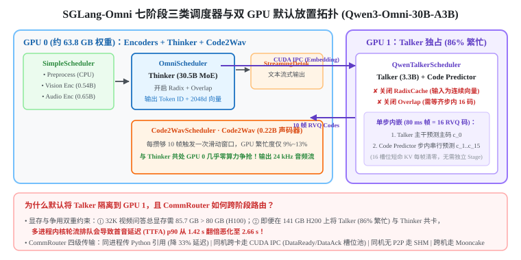
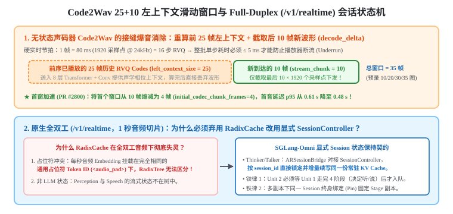

+++
title = 'SGLang 架构精读（二）：SGLang-Omni 七阶段异构调度、流式硬实时声码器与原生全双工状态机'
date = 2026-11-03
draft = false
summary = '深入解析 SGLang-Omni 服务 Qwen3-Omni 与 MiniCPM-o 全双工多模态模型的系统架构（Ch 16–21）：涵盖 80ms 音频帧与 1+15 双层 RVQ 生成、七阶段三类异构调度器、Talker 禁用 RadixCache 与 Overlap Scheduling 的底层原因、CommRouter 四级通信传输层、多模型共卡的 85.7 GB 显存墙与 86% SM 争用博弈、Code2Wav 25+10 左上下文滑动窗口消除接缝爆音，以及 /v1/realtime 原生全双工的 SessionController 跨步状态保持。'
tags = ['SGLang', 'SGLang-Omni', '多模态推理', 'Qwen3-Omni', '全双工语音', '流式解码']
showReadingTime = true
showTableOfContents = true
+++



> 本文基于 Wilson Zheng 的交互式开源教程 **[Learning SGLang — Beyond text · SGLang Omni](https://wilsonzheng0327.github.io/learning-sglang/)**（Ch 16–21）与 **[SGLang-Omni](https://github.com/sgl-project/sglang-omni)** 源码精读整理，为「SGLang 架构精读」三部曲之第二篇（多模态与全双工流式架构篇）。
> - **第一篇**：[从三级页表、Piecewise CUDA Graph 到 MLA 矩阵吸收与投机解码（Ch 01–15）](/notes/llm-inference/sglang-single-gpu-engine/)
> - **第二篇（本文）**：SGLang-Omni 七阶段异构调度、流式硬实时声码器与原生全双工状态机（Ch 16–21）
> - **第三篇**：[DP Attention、Two-Batch Overlap、HiCache 与 Mooncake PD 分离全景（Ch 22–29）](/notes/llm-inference/sglang-distributed-and-disaggregation/)

在[第一篇](/notes/llm-inference/sglang-single-gpu-engine/)中，我们建立在三个隐含假设之上：
1. **单模型单循环**：整个引擎只跑一个 Transformer，所有请求共享同一套 `Scheduler` 步进；
2. **离散 Token ID 寻址**：输入与输出皆为离散整数 Token ID，可直接在 `RadixCache` 上做前缀树哈希匹配；
3. **无硬实时输出死线（Deadline）**：文本流式输出哪怕偶发卡顿 $100\,\text{ms}$，读者也只是觉得光标顿了一下。

一旦进入原生多模态与实时语音交互（以 **Qwen3-Omni-30B-A3B-Instruct** 和全双工 **MiniCPM-o 4.5** 为代表），视觉像素与语音波形同时涌入，模型不仅要边想边说，还要在说话的同时听用户插话——上述三条假设将被逐一击碎。

---

## 一、Omni 模型如何把声音当 Token 生成？（Ch 16）

### 1. $16\,\text{kHz}$ 输入、$24\,\text{kHz}$ 输出与 $80\,\text{ms}$ 音频帧

声音在物理上是连续波形采样点：Qwen3-Omni 以 **$16,000\,\text{Hz}$** 读取用户输入的语音，并以 **$24,000\,\text{Hz}$** 写出合成语音。如果让 Transformer 直接按采样点自回归，每秒要串行跑 $24,000$ 步，在物理上完全不可行。

因此，Qwen3-Omni 引入了多层残差矢量量化（RVQ）音频 Codec，将连续语音切分为 **$80\,\text{ms}$ 的定长帧（每秒 $12.5$ 帧，每帧对应 $24,000 / 12.5 = 1,920$ 个音频采样点）**：
- 每一帧 $80\,\text{ms}$ 的声音由 **$16$ 个离散码本索引（RVQ codes $c_0, c_1, \dots, c_{15}$，每个码本词表大小 $2,048$）** 精确表征；
- 主干大语言模型 **Thinker（$30.5\text{B}$ MoE，A3B）** 负责读取图像、音频与文本特征，自回归生成文本 Token；每当 Thinker 吐出 1 个词，它同时干两件事：
  1. 将 **整数 Token ID** 发往 `Detokenizer` 解码为文字流；
  2. 将该位置的 **$2048$ 维连续 Embedding 与隐状态向量（bf16 占 $4\,\text{KB}$）** 实时发往语音自回归生成器 **Talker（$3.3\text{B}$）**。

---

### 2. 为什么生成 $c_1\dots c_{15}$ 的 Code Predictor 不独立设 Stage？

要凑齐一帧音频的 $16$ 个 RVQ 码，Qwen3-Omni 采用了「双层分级自回归」：
1. **帧级主干（Talker）**：每步接收 Thinker 传来的语义向量与上一帧音频特征，预测当前帧最核心的粗糙主码 **$c_0$**；
2. **帧内细化（Code Predictor）**：紧接着由一个小型自回归 Transformer 解码器读取 Talker 当前帧的隐状态与 $c_0$，**串行跑 $15$ 小步依次预测细节残差码 $c_1, c_2, \dots, c_{15}$**。

一个非常自然的系统设计问题是：**既然 Code Predictor 本身也是一个带 KV Cache 的自回归 Decoder，为什么 SGLang-Omni 没有把它拆成第 8 个独立 Stage 并配一个独立调度器，而是将它硬塞在 Talker 的单步 `forward` 内部执行？**

- **核心原因在于「帧内短命缓存，零跨帧状态」**：
  Code Predictor 的 KV Cache 长度一共只有 **$16$ 个槽位**（Talker 隐状态 $+ c_0 \dots c_{14}$），而且**这 16 个槽位仅在当前这一帧（$80\,\text{ms}$）内部有效，每一帧生成完毕后立即彻底清空归零**！
- 它在帧与帧（Step 与 Step）之间没有任何需要保留或复用的历史 KV 状态，且 Talker 下一步的输入本身就必须等当前帧全部 $16$ 个码凑齐后才能合成。将其内联在 Talker 的单步前向内，既消除了跨进程/跨阶段通信开销，也免去了多余的调度器状态管理。

---

## 二、七阶段、三类调度器与四级通信路由（Ch 17–18）

### 1. 七个 Stage 与三类异构调度器原型（Ch 17）

一条多模态语音请求在 SGLang-Omni 中流经 **7 个阶段**，由于各阶段的计算模式截然不同，SGLang-Omni 抽象出 **3 类调度器**：

| 调度器类别 | 对应类名 | 管辖阶段 (Stages) | 批处理与状态管理行为 |
|---|---|---|---|
| **1. 单次前向型 (One-pass)** | `SimpleScheduler` | `Preprocess`、`Vision Encoder (0.54B)`、`Audio Encoder (0.65B)` | 无跨步 KV Cache；收件箱中有等待请求时立即打包（默认上限 32 条）跑 **1 次前向**即释放 |
| **2. 自回归循环型 (AR Loop)** | `OmniScheduler` / `QwenTalkerScheduler` | `Thinker (30.5B)`、`Talker (3.3B)` | 复用 SGLang 核心 Continuous Batching 与分页池，逐 step 循环生成直至遇终止符 |
| **3. 流式积攒窗口型 (Streaming)** | `StreamingDetokenizeScheduler` / `Code2WavScheduler` | `Detokenizer`、`Code2Wav (0.22B)` | 维护每个请求的流式接收缓冲，每攒够固定阈值（如 $10$ 帧 RVQ 码）触发一次窗口解码并推送 SSE 事件 |

---

### 2. 为什么 Talker 必须强制关闭 `RadixCache` 与 `Overlap Scheduling`？

`Thinker` 和 `Talker` 虽然同属自回归循环型（继承自 `OmniScheduler`），但 `Talker` 的专属调度器 **`QwenTalkerScheduler` 显式关掉了 SGLang 最引以为傲的 `RadixCache`（前缀缓存）与 `Overlap Scheduling`（双缓冲重叠调度），并额外加了一道批次就绪门控（Batch Ready Check）**。为什么？

1. **为什么增加「批次就绪门控（Hold Decode Batch）」？**
   纯文本 LLM（如 Thinker）下一步的输入就是它自己上一步采样出的词，永远自给自足；但 Talker 每往前走一步，都必须消费上游 Thinker 传来的下一个文本 Token Embedding！因此 `QwenTalkerScheduler` 必须**按住当前正在跑的 Decode 批次，直到批次内每一条请求都收到了来自 Thinker 的下一步输入向量**才允许发车（若某条请求的 Thinker 文本已提前生成完毕，则自动喂入 `pad` 向量让 Talker 继续把剩余语音帧说完）。
2. **为什么必须关闭 `RadixCache`？**
   在[第一篇](/notes/llm-inference/sglang-single-gpu-engine/)中我们知道，`RadixTree` 匹配前缀的唯一依据是**离散整数 Token ID 的精确相等**。而 Talker 接收的 Prompt 与每步流式输入全都是 Thinker 传过来的 **`[2048]` 维连续浮点 Embedding 向量**，根本不存在离散 Token ID 序列，自然无法在前缀树上做哈希匹配。
3. **为什么必须关闭 `Overlap Scheduling`？**
   `Overlap Scheduling` 之所以能让 GPU 马不停蹄，前提是“下一步输入仅依赖上一步采样出的单个 Token ID，且无需跨阶段等待”。而 Talker 下一步的输入不仅必须等上一步主干 $c_0$ 与步内嵌的 15 步 Code Predictor ($c_1\dots c_{15}$) 全部串行跑完并聚合成帧特征，还要等待跨阶段异步到达的 Thinker 向量，双缓冲无等待假设不再成立。

---

### 3. 八条跨阶段边与 `CommRouter` 的四级自适应传输（Ch 18）

7 个 Stage 之间由 8 条有向数据边连接（传输内容涵盖原始张量、$2048$ 维 bf16 编码向量与 RVQ 码）。SGLang-Omni 的 **`CommRouter`（`comm/router.py`）** 根据上下游两个 Stage 所在的进程与硬件拓扑，自动为每条边选择 4 种传输层之一，并配合 ZMQ 上的 **`DataReadyMessage` / `DataAckMessage` 握手协议** 实现零泄漏流转：

1. **同进程引用传递（Plain Python Reference）**：当上下游 Stage 运行在同一进程内时，直接传递内存对象引用（零序列化、零拷贝）。SGLang-Omni 设计文档（PR #496）实测表明，将纯文本管线从统一中继改为同进程传引用后，**平均端到端延迟直接下降了 $33\%$**。
2. **同机跨卡 P2P 直传（CUDA IPC）**：当上下游位于同一台机器的不同 GPU 进程且支持 NVLink/P2P 时，发送方将数据写入本地 GPU 上预先分配的**固定大小槽位池（Slot Pool）**，随后通过 ZMQ 发送极轻量的 `DataReadyMessage`（仅含请求 ID 与显存句柄偏移）；接收方 GPU 直接跨 NVLink 读取对端显存，读取完毕后回发 `DataAckMessage` 归还槽位。
3. **主机共享内存（Shared Memory `/dev/shm`）**：同机跨进程但张量位于 CPU，或两张 GPU 之间不支持 P2P 访问时的回退路径。
4. **跨机 RDMA 传输（Mooncake Transfer Engine）**：当上下游 Stage 分布在不同物理节点时，走零拷贝 RDMA 网络。

---

## 三、多模型共卡：85.7 GB 显存墙与 86% SM 争用博弈（Ch 19）

我们把 Qwen3-Omni-30B-A3B 全套 bf16 权重的账本加起来：
- `Thinker`：$30.5\text{B} \times 2\,\text{B} = 61.0\,\text{GB}$
- `Talker + Code Predictor`：$3.3\text{B} \times 2\,\text{B} = 6.6\,\text{GB}$
- `Audio Encoder (0.65B)` + `Vision Encoder (0.54B)` + `Code2Wav (0.22B)`：合计约 $2.9\,\text{GB}$
- **全模型权重总计 $= 70.5\,\text{GB}$**。

既然 $70.5\,\text{GB} < 80\,\text{GB}$，为什么 SGLang-Omni 的默认语音配置（`speech`）拒绝单张 H100，非要默认使用 **2 张 GPU**，而且偏偏把 **$0.22\text{B}$ 的 `Code2Wav` 留在 GPU 0 跟庞大的 `Thinker` 挤在一起，却把 $3.3\text{B}$ 的 `Talker` 单独隔离到 GPU 1 上**？

这里藏着两个硬核的物理与实测证据（数据引自教程 Ch 19 及 SGLang-Omni PR #883、PR #1235 实测记录，非本文复现实验）：

### 1. 证据一：长视频问答下的 $85.7\,\text{GB}$ 显存墙

在单张 80 GB H100 上跑短文本语音合成（几百 token Prompt）确实可以塞进单卡（即 `speech-colocated` 配置，将 Thinker 显存份额压缩至 $78\% \approx 62.4\,\text{GB}$）。但在 Video-MME 视频理解基准（并发 16 条视频、支持最高 $32,768$ 上下文长度）下，单卡最低显存需求为：
- 模型总权重：$70.5\,\text{GB}$
- Thinker 32K 上下文保底 KV Cache（$32768 \times 96\,\text{KB}$）：$3.1\,\text{GB}$
- 视频编码器激活峰值预留（`encoder_mem_reserve = 5%`）：$4.0\,\text{GB}$
- CUDA Graph、工作区及各 Stage 基础缓存预留：$\approx 8.1\,\text{GB}$
- **总计 $= 85.7\,\text{GB} > 80\,\text{GB}$**！单张 H100 在物理上根本装不下 bf16 视频问答管线。

### 2. 证据二：即便在 141 GB H200 上共卡，SM 排队争用也会让首音延迟 p90 翻倍！

那么在显存高达 $141\,\text{GB}$ 的 H200 上，显存完全够用，总可以把 `Talker` 放回 GPU 0 跟 `Thinker` 共卡了吧？
SGLang-Omni PR #1235 在 H200 上对 8 并发请求做了严格对比实验：
- **Talker 是高频算力大户（独占 GPU 时繁忙度高达 $86\%$）**：因为每生成一帧 $80\,\text{ms}$ 音频，Talker 都要连跑 $1 + 15 = 16$ 次串行自回归小步！
- 当默认未开启 NVIDIA MPS 时，同一张 GPU 上的两个独立进程（Thinker 进程与 Talker 进程）无法真正同时在 SM 上并行执行内核，只能**轮流排队抢占 GPU（Taking Turns）**。
- **灾难性后果**：Talker 高频的 16 步帧生成不断被 Thinker 沉重的 MoE/Attention 算子插队阻塞，导致**首音延迟（Time-to-First-Audio, TTFA）的 p90 从独占卡时的 $1.42\sim 1.46\,\text{s}$ 直接翻倍恶化到 $2.66\sim 2.70\,\text{s}$**，停顿等待时间翻了一倍！
- **为什么 `Code2Wav` 可以安心留在 GPU 0？** 因为 `Code2Wav` 每攒够 10 帧（$800\,\text{ms}$ 语音）才唤醒跑一次窗口，**GPU 繁忙度仅有 $9\%\sim 13\%$**，塞在 GPU 0 的空隙里几乎不与 Thinker 产生任何算力争抢！

---

## 四、流式音频硬实时解码与原生全双工状态机（Ch 20–21）

### 1. $5\,\text{ms/step}$ 硬实时死线与 $25 + 10$ 左上下文重算（Ch 20）

在流式语音生成中，客户端播放器一旦把已收到的音频块播完而下一个音频块还没送到，就会发生**播放断流（Playback Underrun）**。
- **硬实时节拍算术**：每一帧代表 $80\,\text{ms}$ 的声音，背后需要 **1 步 Talker $+ 15$ 步 Code Predictor $= 16$ 个串行步**（每一步都依赖上一步采样出的码）。因此，要想生成速度跟上实时播放速度（Real-Time Factor $\text{RTF} \le 100\%$），整个批次每一步的平均耗时必须严守：
  $$t_{\text{step}} \le \frac{80\,\text{ms}}{16\text{ steps}} = \mathbf{5.0\,\text{ms}}$$
  （在单张 H100 跑 16 并发语音合成时，SGLang-Omni 实测平均 RTF 约为 $38\%$，即生成速度约为实时语速的 $2.6$ 倍）。

接下来是一个极其关键的声学工程问题：**当 `Code2WavScheduler` 每攒够 $N=10$ 帧新 RVQ 码触发一次解码（`stream_chunk_size=10`）时，为什么它不直接只算这 10 帧，而是非要把前面已经播过的 $L=25$ 帧历史旧码捞出来拼成 $25 + 10 = 35$ 帧一起重算，算完又把前 25 帧的波形扔掉？**

- **无状态声码器的接缝爆音（Seam Artifacts）**：
  `Code2Wav` 由 8 层 Transformer（每层感受野回看达 72 帧）与上采样卷积层组成。不同于 Thinker/Talker，**`Code2Wav` 在两次窗口调用之间不保留任何 KV Cache 或卷积状态**，每次调用都是一次从零开始的无状态前向。
- 如果窗口 1 只算第 $1\dots 10$ 帧，窗口 2 只算第 $11\dots 20$ 帧，那么第 11 帧开头在卷积与注意力计算时完全看不到第 10 帧结尾的声学波形相位，两段音频拼在一起就会在每 $800\,\text{ms}$ 交界处产生刺耳的**相位撕裂与爆音**！
- **左上下文滑动窗口（`decode_delta`）与首窗缩减**：
  通过在每次解码新 10 帧时带上最多 **$25$ 帧历史左上下文（`left_context_size=25`）** 一起送入模型（并为 $10, 20, 30, 35$ 帧四种窗口尺寸预录 CUDA Graph），新 10 帧的左边界在充足的历史感受野下变得完美平滑；算完后只需丢弃前 25 帧冗余波形，**仅截取最后 $10 \times 1,920$ 个采样点下发**即可！
  此外，为了避免第一声输出苦等攒满 10 帧（$800\,\text{ms}$），将**首个窗口缩减为 4 帧（`initial_codec_chunk_frames=4`）**、后续窗口恢复 10 帧（PR #2800），在几乎不损失吞吐（$12.79 \to 12.64\,\text{req/s}$）的前提下，将 H200 上 16 并发的首音延迟 p95 从 $0.61\,\text{s}$ 直接压降至 **$0.48\,\text{s}$**。

---

### 2. 原生全双工（`/v1/realtime`）：为什么必须弃用 `RadixCache` 改用 `SessionController`？（Ch 21）

传统的回合制语音助手（Turn-based + Silero VAD 静音检测）有两个无解的体验痛点：
1. 用户说话中途停顿思考 $800\,\text{ms}$，VAD 误以为用户说完了，直接截断抢话；
2. 模型正在回答时，用户礼貌性地“嗯”了一声或环境有杂音，VAD 立刻粗暴打断正在生成的回答。

原生全双工模型（如 **MiniCPM-o 4.5** 按 $1\,\text{s}$ 切片、**PersonaPlex** 按 $80\,\text{ms}$ 切片，挂载于 `/v1/realtime` 接口）彻底废除了回合制：客户端每 **1 秒** 切一段实时音频，作为一个独立的 Request 送入 `perception` $\rightarrow$ `thinker` $\rightarrow$ `talker` $\rightarrow$ `speech` 四阶段管线；模型在每一秒切片结束时自主决定这一秒是**保持安静继续听（Listen）**还是**开口说话（Speak）**。

这立刻撞上了一个致命的系统冲突：**在 SGLang 中，一条 Request 跑完就会释放状态；既然每 1 秒音频切片都是一个独立 Request，为什么不能像多轮文本聊天那样直接用 `RadixCache` 自动匹配并复用上一秒的 KV Cache？**

- **根本原因一：连续音频 Embedding 挂载在统一的「占位符 Token ID」下！**
  `RadixCache` 的前缀树只能按**离散整数 Token ID** 做相等匹配。而在全双工会话中，每一秒的用户音频是由 `Perception` 编码成连续浮点 Embedding，并挂载在一串**完全相同的通用占位符 Token ID（Placeholder IDs，如 `<audio_pad>`）** 下传给 `Thinker` 的！
  不管是张三说的第 1 秒“你好”，还是李四说的第 2 秒“明天见”，它们在 `TokenizedGenerateReqInput` 里的整数 Token ID 序列长得一模一样！如果允许它们进入 `RadixCache`，前缀树根本无法区分不同音频内容，当场就会发生灾难性的跨用户/跨秒错误命中！因此 `ar_session.py` **显式禁止全双工切片进入 RadixTree**。
- **根本原因二：非 LLM 阶段拥有无法放入前缀树的流式状态**。
  `Perception`（音频编码器的跨秒隐状态与上一秒末尾音频切片）与 `Speech`（声码器跨秒状态，单会话上限 `2 GiB`）根本不是 LLM，不存在所谓的 Token 前缀树。

为此，SGLang-Omni 构建了独立于 `RadixCache` 的 **`Session` 显式状态机（`SessionController` + `SessionHooks`）**：
1. **五原语生命周期与防串台标识**：客户端通过 `open` $\rightarrow$ `append` $\rightarrow$ `control`（打断）$\rightarrow$ `read` $\rightarrow$ `close` 操控会话；每个会话由 `SessionIdentity(id, open_index)` 唯一标识，确保同一 `id` 关闭后立即重开也绝不会继承旧会话残留的脏状态。
2. **双轨状态托管**：
   - 在 `Perception` 与 `Speech` 阶段，`SessionScheduler` 调用各阶段注册的 `SessionHooks` 在内存中按会话游标维护编码器与声码器状态；
   - 在 `Thinker` 与 `Talker` 阶段，`ARSessionBridge` 对接 SGLang 核心的 **`SessionController`**——每次 1 秒的 `append` 请求到达时，直接按 `session_id` 绑定到那份常驻未释放的 Session KV Cache 上增量续写，完全绕开 `RadixTree` 匹配。
3. **全双工管线的两条保命铁律**：
   - **铁律 ①（单会话严格串行，禁止跨 Stage 流水并发）**：同一个会话的第 2 秒切片（Unit 2），**绝对不能**在第 1 秒切片（Unit 1）还在 `Talker` 里的时候就提前塞进 `Perception`！因为只有等 Unit 1 走完所有 4 个 Stage，模型才真正做出“这一秒说没说话”的决策并完成全链路状态更新，Unit 2 必须基于 Unit 1 尘埃落定后的状态起步。
   - **铁律 ②（多副本终身亲和绑定 Replica Pinning）**：当某个 Stage 部署了多个副本时，`CoordinatorSessions` 会将同一个 Session 在整个生命周期内死死绑定在每个 Stage 的**同一个副本实例**上（因为该会话的显存/内存状态只驻留在那个副本中）。

---

## 五、多模态篇小结：从单循环到异构有向图

回顾 Ch 16–21，SGLang-Omni 向我们展示了当推理引擎迈向全模态与实时流式交互时的完整演进：
- 在**阶段内部**，按计算特性拆解为 `SimpleScheduler`（单次编码）、`OmniScheduler`（自回归循环）与 `StreamingVocoderBase`（滑动窗口）；
- 在**阶段之间**，用 `CommRouter` 自适应匹配同进程引用、CUDA IPC、共享内存与 Mooncake RDMA，并用双卡隔离化解 $85.7\,\text{GB}$ 显存墙与 Talker $86\%$ 繁忙度引发的 p90 延迟翻倍；
- 在**时间维度**，用 $25+10$ 左上下文重算消除无状态声码器的接缝爆音，并用 `SessionController` + `SessionHooks` 填补了连续模态无法使用 `RadixCache` 的空白。

解决了单机与多模态管线后，如果我们面对的是像 **DeepSeek-V3（671B 参数、MLA + 256 专家 MoE）** 这样连权重带缓存远超单张甚至单台 GPU 极限的庞然大物，SGLang 是如何榨干多卡与多机集群的？请继续阅读收官篇：**[第三篇：DP Attention、Two-Batch Overlap、HiCache 与 Mooncake PD 分离全景（Ch 22–29）](/notes/llm-inference/sglang-distributed-and-disaggregation/)**。
