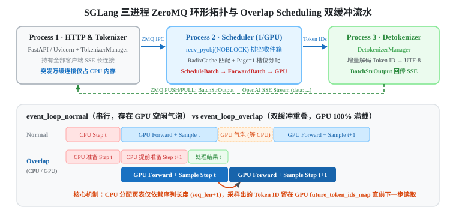
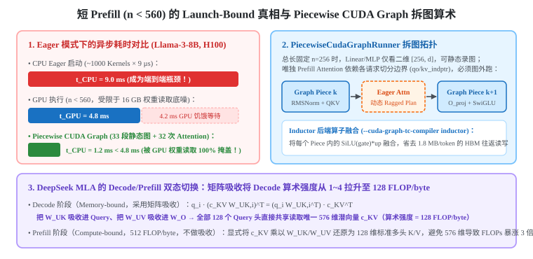

+++
title = 'SGLang 架构精读（一）：从三级页表、Piecewise CUDA Graph 到 MLA 矩阵吸收与投机解码'
date = 2026-11-03
draft = false
summary = '以单步耗时方程 t_step = max(t_cpu, t_comm, max(t_mem, t_compute)) 与 H100 上 Llama-3-8B 的硬件账本为主线，系统拆解 SGLang 单卡引擎与编译器栈（Ch 01–15）：涵盖 page_size=1 三级页表、RadixCache 末位盲区、Overlap Scheduling 双缓冲闭环、Piecewise CUDA Graph 拆图算术、Dynamo/Inductor 融合、DeepSeek MLA 矩阵吸收（128 FLOP/byte）及三代投机解码（EAGLE-3 / DFlash / DSpark）。'
tags = ['SGLang', 'LLM 推理', 'KV Cache', 'RadixAttention', 'CUDA Graph', 'MLA', '投机解码']
showReadingTime = true
showTableOfContents = true
+++



> 本文基于 Wilson Zheng 的交互式开源教程 **[Learning SGLang — Inference engines, from the problems up](https://wilsonzheng0327.github.io/learning-sglang/)**（Ch 01–15）与 SGLang 源码精读整理，为「SGLang 架构精读」三部曲之第一篇（单卡引擎与编译器极限篇）。
> - **第一篇（本文）**：单卡核心循环、显存池、Piecewise CUDA Graph、MLA 矩阵吸收与投机解码（Ch 01–15）
> - **第二篇**：[SGLang-Omni 七阶段异构调度、流式硬实时声码器与原生全双工状态机（Ch 16–21）](/notes/llm-inference/sglang-omni-full-duplex/)
> - **第三篇**：[DP Attention、Two-Batch Overlap、HiCache 与 Mooncake PD 分离全景（Ch 22–29）](/notes/llm-inference/sglang-distributed-and-disaggregation/)

现代大模型推理引擎代码库动辄十余万行，涵盖前缀树、页表分配、双缓冲异步流水、编译器 FX 拆图、五六种 Attention 内核以及各式投机采样算法。但如果我们从第一性原理出发，所有这些模块其实都在围剿**同一个单步耗时最大值方程**：

$$t_{\text{step}} = \max\!\Big(\underbrace{t_{\text{cpu}}}_{\text{调度与算子下发}},\; \underbrace{t_{\text{comm}}}_{\text{跨卡/跨机传输}},\; \underbrace{\max\!\big(t_{\text{mem}}(\text{Weights} + \text{KV}),\; t_{\text{compute}}\big)}_{\text{GPU 核心执行}}\Big)$$

只要把硬件常数代入这个方程，每一个看似复杂的工程设计都会变成水到渠成的必然推论。

---

## 一、全书黄金硬件标尺：Llama-3-8B on 1× H100 SXM

为了避免空谈定性结论，我们先锁定一套贯穿全文的定量基准：**Llama-3-8B（bf16）运行在单张 NVIDIA H100 SXM（80 GB HBM）** 上（数据口径来自教程基准设定与官方硬件规格）：

| 物理量 | 数值与推导公式 | 物理意义与系统推论 |
|---|---|---|
| **H100 峰值算力 / 带宽** | $989\,\text{TFLOP/s}$ / $3.35\,\text{TB/s}$ | 硬件算力带宽平衡点 $n^* = \frac{989}{3.35} \approx \mathbf{295\,\text{FLOP/byte}}$（计入实际算子效率时拐点约为 $300\sim 560$ tokens） |
| **模型权重体积 $2P$** | $\approx 16\,\text{GB}$（扣除只查表不流式遍历的 $1\,\text{GB}$ Embedding 实读约 $15\,\text{GB}$） | 哪怕单步只跑 $1$ 个 token，GPU 把权重从 HBM 流式读入寄存器至少需要固定的底噪时间 |
| **单步权重读取底噪 $t_{\text{mem}}$** | $\frac{16\,\text{GB}}{3.35\,\text{TB/s}} \approx \mathbf{4.8\,\text{ms}}$ | **单卡最重要常数**：任何低于 $4.8\,\text{ms}$ 的 CPU 开销或额外计算，只要能与权重读取异步重叠，端到端耗时就是零成本 |
| **单 Token KV Cache 体积** | $2 \times 32\,\text{层} \times 8\,(\text{GQA KV 头}) \times 128\,(\text{维}) \times 2\,\text{B} = \mathbf{128\,\text{KB/token}}$ | 在 $B=256$、上下文长度 $n \approx 480$ 时，KV Cache 读取量（$16\,\text{GB}$）追平模型权重；在 $n=4096$ 时 KV 读取高达 $137\,\text{GB}$（耗时 $41\,\text{ms}$） |

在这套标尺下，一个包含 $n$ 个 token 的前向步，其计算耗时与访存耗时分别为：

$$t_{\text{compute}}(n) = \frac{2Pn}{\text{FLOP/s}}, \qquad t_{\text{memory}}(n) = \frac{2P + \text{KV Cache}}{\text{bytes/s}}$$

- **Prefill 阶段**（一次性输入整段 Prompt，$n \gg n^*$）：处于算力受限区（**Compute-bound**），主导首字延迟（TTFT）。SGLang 在此做了一个精细优化：分类输出头 `lm_head` **只在 Prompt 的最后一个位置执行计算**，省去了前 $L-1$ 个位置的无效词表投影。
- **Decode 阶段**（每个请求每步仅输入 $1$ 个新 token，$n = B$）：在小 Batch 下处于严重的显存带宽受限区（**Memory-bandwidth bound**），主导每字生成延迟（TPOT）。

---

## 二、The Loop：三级显存池、RadixCache 与双缓冲调度（Ch 05–10）

### 1. 为什么默认开启 Chunked Prefill 仍会冻结 Decode？（Ch 05–06）

在 Continuous Batching（连续批处理）中，`Scheduler.get_next_batch_to_run()` 每步需要在「准入新请求做 Prefill」与「推进存量请求做 Decode」之间做抉择。

一个常被忽略的工程细节是：**SGLang 虽然默认开启了分块预填充（`--chunked-prefill-size 8192`），但单靠它并不会消除长 Prompt 造成的 Decode 卡顿！**
- 原因在于 SGLang 默认采用 **Prefill 优先策略**：当一条 $24\,\text{K}$ 的长 Prompt 被切成 3 个 $8\,\text{K}$ 的 chunk 后，调度器会在连续 3 个 step 中一口气跑完这 3 个 chunk，期间正在生成中的 Decode 请求依然会被整体冻结。
- 要真正消除冻结气泡，SGLang 提供了两把钥匙：
  1. **步进交错（`--prefill-decode-interval N`）**：每跑完 1 个 Prefill 块后强制穿插运行 $N$ 步 Decode。当 $N=1$、块上限为 $c$ 时，Decode 步的最大停顿被锁死在 $\text{gap} \approx c \cdot t_{\text{tok}} + t_{\text{step}}$。
  2. **混合分块（`--enable-mixed-chunk`）**：将大小不超过 $c \le n^* - B$ 的 Prefill chunk 直接塞进当前的 Decode 批次里一起跑。由于 Decode 批次原本算力闲置（只花 $4.8\,\text{ms}$ 读权重），混入 $c$ 个 Prefill token 几乎不增加单步耗时，彻底消除了调度停顿气泡，使 $\text{TTFT} \approx \lceil P/c \rceil \cdot t_{\text{step}}$。

---

### 2. SGLang 三级显存池与 `page_size=1` 寻址契约（Ch 07）

为了彻底根除连续预分配造成的显存碎片，SGLang 将 KV 显存管理拆解为职责清晰的三个类：

1. **`MHATokenToKVPool`（物理显存池）**：服务启动时按 `--mem-fraction-static`（H100 上约为 $f \approx 0.83$，预留其余 $17\%$ 给激活峰值与 CUDA Graph）一次性分配大小约为 $f \cdot \text{HBM} - \text{weights} \approx 55\,\text{GB}$ 的连续大张量。
2. **`TokenToKVPoolAllocator`（物理槽位分配器）**：负责维护空闲槽位栈并发放物理索引。不同于传统分页默认 16 tokens/page，**SGLang 默认采用 `page_size = 1`**（即 1 个 page 就是 1 个 token 的物理槽位），从根源上消除了页内末尾碎片（$p - 1 = 0$）。
3. **`ReqToTokenPool`（请求级逻辑页表）**：形状为 `[max_reqs, max_context_len]` 的二维整数张量，将每个请求的第 $t$ 个逻辑位置直接映射为物理槽位号 `kv_slot`。

在准入控制（`PrefillAdder`）上，SGLang 并不会死板地按用户传入的 `max_new_tokens` 全额扣减预留空间，而是乘以一个**从 `0.7` 动态衰减至 `0.1` 的乐观估算系数 `new_token_ratio`**（因为绝大多数请求远在达到最大长度前就会输出 EOS 提前结束）。万一高并发下乐观估计导致某步 Decode 显存槽位不足，调度器会触发 **`retract_decode`（回撤机制）**——优先挑出**当前已生成输出 token 数最少**的请求，释放其槽位并退回等待队列稍后重算，以最小代价化解显存死锁。

---

### 3. RadixCache 的「末位 Token 盲区」与 LPM 防饥饿退化（Ch 08）

由于自回归注意力中位置 $i$ 的 $K_i, V_i$ 仅取决于前缀序列 $1\dots i$，SGLang 使用压缩前缀树（`RadixCache`）管理所有历史与活跃请求的 KV 页面：运行中请求命中的祖先路径通过引用计数 `ref_cnt > 0` 锁定保护；请求结束时 `ref_cnt` 递减归零但物理数据保留在显存池中，仅在空闲槽位耗尽时按 **叶子节点优先的 LRU 最小堆** 级联淘汰。

这里有两个极易踩坑的源码级边界性质：
1. **为什么多轮对话中，上一轮生成的最后一个 Token 永远无法命中 `RadixCache`？**
   假设第一轮对话（Prompt + 模型回答）共 150 个 token。当模型在第 149 个位置前向结束并由 Sampler 采样出第 150 个 token（如停止词或句末词）时，第一轮请求立即终止——**这第 150 个 token 仅仅作为采样输出产生，从未作为输入送入模型执行过 `forward`，因此物理显存中根本没有写下第 150 个位置的 $K_{150}$ 和 $V_{150}$！** 当第二轮对话携带完整历史再来匹配时，最多只能命中前 149 个 token，第 150 个 token 必定与第二轮的新 Prompt 一起重新执行 Prefill。
2. **LPM 调度的防饥饿退化**：开启 `--schedule-policy lpm`（Longest Prefix Match）虽然能将等待队列按命中前缀长度排序以最大化缓存复用，但为了防止无共同前缀的新请求被无限期饿死，**一旦 `waiting_queue` 积压超过 128 条请求，SGLang 会自动将策略退化回默认的 `fcfs`（先来先服务）**。

---

### 4. 三进程 ZeroMQ 环形拓扑与 Overlap Scheduling 双缓冲流水（Ch 09–10）

为了避免千级客户端 HTTP/SSE 连接与分词任务阻塞毫秒级的 GPU 步进循环，`sglang serve` 启动三个独立进程并通过 Unix Domain Socket 上的 **ZeroMQ `ipc://` PUSH/PULL 单向管道** 串联成环：



在 `Scheduler` 进程（`managers/scheduler.py`）内部，串行循环 `event_loop_normal` 每步依次执行：

```python
while True:
    ingest_requests()                      # ZMQ 非阻塞收件 (NOBLOCK) -> 构造 Req 放入 waiting_queue
    batch = get_next_batch_to_run()        # 合并上步 prefill、查 RadixCache、从 Allocator 分配页
    if batch is None:
        on_idle()
        continue
    result = run_batch(batch)              # ScheduleBatch -> ForwardBatch -> ModelRunner -> Sampler
    process_batch_result(batch, result)    # 追加 token、检查 EOS、释放/保留页、发 BatchTokenIDOutput
```

而在生产环境默认启用的 **`event_loop_overlap`（Overlap Scheduling）** 中，CPU 在第 $t$ 步的 GPU 内核还在运行时，就已经提前跑完了第 $t+1$ 步的 `get_next_batch_to_run()`。

这里有一个非常精妙的悖论：**当 CPU 提前准备第 $t+1$ 步的 `ForwardBatch` 时，第 $t$ 步的 GPU 前向和采样根本还没跑完，CPU 甚至不知道第 $t$ 步采样出了哪个词，它怎么准备第 $t+1$ 步的输入与页表？**
- **答案是「页表元数据与具体 Token 值完全解耦」**：在 Decode 阶段，第 $t+1$ 步需要分配哪个物理 KV 槽位、页表长度增加 1、Attention 的 CSR 索引指向哪里，**只取决于序列长度 `seq_len + 1`，与第 $t$ 步采样出的究竟是 `"Paris"` 还是 `"London"` 毫无关系！**
- 至于第 $t+1$ 步真正的输入词，CPU 只传一个指向 GPU 显存映射表（`future_token_ids_map`）的占位索引；当第 $t$ 步的 Sampler 在 GPU 上跑完时，直接把采样出的 Token ID 写进该 GPU 显存缓冲区，第 $t+1$ 步的 Embedding 层直接在 GPU 上原地读取，全程无需等待 CPU-GPU 同步！

---

## 三、Making One GPU Fast：分段图、编译器融合、MLA 与投机解码（Ch 11–15）

### 1. 为什么 Decode 能整图捕获，而短 Prefill 必须在 Attention 处拆图？（Ch 11–12）

在 Eager 模式下，32 层 Llama-3-8B 单步前向包含约 $N_{\text{kernels}} \approx 1000$ 个小算子，CPU 每次通过驱动下发算子耗时约 $t_{\text{launch}} \approx 9\,\mu\text{s}$，因此 **CPU 光下发完一步算子就要花掉固定的 $t_{\text{cpu}} \approx 1000 \times 9\,\mu\text{s} = 9.0\,\text{ms}$**。

很多人误以为“只有小 Batch Decode 才是 Launch-bound，Prefill 肯定是 Compute-bound”。但让我们把数字代入异步耗时方程：

$$t_{\text{step}}(n) = \max\!\Big(\underbrace{t_{\text{cpu}}}_{9.0\,\text{ms}},\; \underbrace{\max\!\big(4.8\,\text{ms},\; n \cdot t_{\text{tok}}\big)}_{t_{\text{gpu}}(n)}\Big)$$

- **惊人的真相**：当 Prefill 或 Mixed Chunk 的总 token 数 **$n < 560$** 时，GPU 的算力根本没有打满，GPU 执行完整个 step 只需要 $4.8\,\text{ms}$（读一遍 16 GB 权重的底噪），而 **CPU Eager 下发却要花 $9.0\,\text{ms}$**！换言之，**所有 $n < 560$ 的短 Prefill / 增量 Prefill 在 Eager 模式下全都是 CPU Launch-bound（每步白白浪费 $4.2\,\text{ms}$ 的 GPU 空转气泡）！**

既然如此，为什么不能像 Decode 阶段（`CudaGraphRunner`）那样，直接用 1 张整模型 CUDA Graph 把 Prefill 也包起来？



这涉及 CUDA Graph 最核心的底层契约：
- **为什么 Decode 同样用动态 Paged/Radix Attention 却能整图捕获（Ch 11）？**
  CUDA Graph 录制时固化的是传给内核的**显存虚拟地址指针（Pointer Address）与启动网格维度（Grid/Block Size）**，并不锁死指针指向的具体数值。在 Decode 阶段，每个请求固定只有 **`q_len = 1` 个 Query token**。只要把批次大小 $B$ 向上 pad 到固定档位（`--cuda-graph-bs`），Attention 内核的启动网格就完全固定；重放（`replay()`）前，CPU 只需把当步最新的 `kv_indptr` 与 `kv_indices` 页表数据 `copy_()` 覆盖写进预先分配好的**固定显存地址静态缓冲区（Static Buffer）**，整张 Decode 图即可无缝读取新页表。
- **为什么 Prefill 总长固定为 $n=256$ 时，唯独 Attention 会破图（Ch 12）？**
  在 Prefill 阶段，同样是总长 $n=256$ 个 token：
  - 包裹在 Attention 两侧的 **Linear / RMSNorm / SiLU** 只看到展平后的二维矩阵 `[256, 4096]`——这 256 个 token 究竟来自「1 条长 256 的请求」还是「16 条长 16 的请求」，矩阵乘与逐元素算子完全无感，天然可以录进静态 CUDA Graph！
  - 但 **Prefill Attention（`forward_extend`）** 必须严格遵守请求间的因果隔离边界（`qo_indptr`）与各请求长短不一的历史前缀长度（`kv_indptr`），其底层内核分块调度（`plan()`）与启动网格随批次内请求切分方式动态变化，无法用单一静态图固化。
- **`PiecewiseCudaGraphRunner` 的 $1.2\,\text{ms}$ 掩盖艺术**：
  SGLang 借用 `torch.compile` 的 **Dynamo** 前端追踪 FX 图，在 32 层模型的每一个 Attention 算子处将图切开，拆成 **33 段静态 CUDA Graph（覆盖全部 Linear/RMSNorm/SiLU）+ 32 次图外 Eager Attention**。
  此时 CPU 单步下发耗时从 $9.0\,\text{ms}$ 骤降至：
  $$t_{\text{cpu, piecewise}} = 33 \times 10\,\mu\text{s} + 32 \times 3 \times 9\,\mu\text{s} \approx \mathbf{1.2\,\text{ms}}$$
  虽然 $1.2\,\text{ms}$ 比单张整图重放（$\sim 20\,\mu\text{s}$）慢了 60 倍，但因为 **$1.2\,\text{ms} < 4.8\,\text{ms}$（GPU 权重读取底噪）**，放进 $\max(1.2\,\text{ms}, 4.8\,\text{ms}) = 4.8\,\text{ms}$ 后，**这 $1.2\,\text{ms}$ 的 CPU 开销被 GPU 读权重的 $4.8\,\text{ms}$ 100% 异步掩盖**，实现了与“零开销完美整图”完全相同的端到端延迟！

---

### 2. `torch.compile` 的两半：Dynamo 拆图 vs Inductor 算子融合（Ch 13）

在 `PiecewiseCudaGraphRunner` 中，`--cuda-graph-tc-compiler` 控制着 `torch.compile` 的两半如何配合：
- **`eager`（默认）**：仅使用前半截 **Dynamo**（Python 字节码追踪器）把模型拆成 33 段 FX 子图并录制成 CUDA Graph，专门消除 **CPU Launch 开销**。
- **`inductor`**：对切出来的 33 段静态子图进一步启用后端编译器 **Inductor**。Inductor 不会从零手写矩阵乘（MatMul 仍交给 cuBLAS / CUTLASS / Triton 模板并做 epilogue 融合），但它会将连续的逐元素与归约算子链（如 SwiGLU 中的 `SiLU(gate) * up`、残差加法与 `RMSNorm`）融合进单个生成的 Triton 内核，消灭中间激活写回 HBM 再立刻读出的往返流量：
  - **融合账本**：Llama-3-8B 的 SwiGLU 中间层宽度为 $14336$（bf16 下每 token 占 $28\,\text{KB}$）。未融合时，`SiLU` 写回 $28\,\text{KB}$、乘法再读入 $28\,\text{KB}$；融合后每层每 token 省去 $56\,\text{KB}$ HBM 流量，32 层合计省去 **$1.8\,\text{MB/token}$**。在 $n=256$ 时单步省去约 $470\,\text{MB}$ HBM 读写（约 $140\,\mu\text{s}$，约为 $16\,\text{GB}$ 权重读取的 $3\%$；若叠加 FP8 量化节点的融合，端到端收益可达 $\sim 8\%$）。

---

### 3. 五大 Attention Backend 与 DeepSeek MLA 矩阵吸收推导（Ch 14）

为什么一个标准注意力公式 $\text{Softmax}(QK^\top / \sqrt{d})V$ 在 SGLang 中需要维护 `fa3`、`flashinfer`、`triton`、`flashmla`、`trtllm_mha/mla` 等五六套后端？因为在不同阶段与架构下，Attention 的**算术强度（FLOP/byte）**跨越了整整两个数量级（对比 H100 平衡点 $\approx 295\,\text{FLOP/byte}$）：

| 注意力形态 | 算术强度 (FLOP/byte) | 硬件瓶颈分类 | 核心内核机制与 SGLang 默认路由 |
|---|---|---|---|
| **MHA Decode**（单 Q 头对单 KV 头） | $\frac{2d + 2d}{2d + 2d} = \mathbf{1}$ | 极度访存受限（低平衡点 300 倍） | 纯显存抽水机（Memory Pump），需 Split-KV 并行切分历史序列以打满 SM |
| **GQA Decode**（Llama-3-8B，$g=4$） | $\mathbf{4}$ | 访存受限（Memory-bound） | 每读 1 次 K/V 被 4 个 Q 头复用；`flashinfer` 通过 CPU `plan()` 动态均衡长短请求分块 |
| **GQA Prefill**（Query 分块高 $B_r=128$） | $4 \times 128 = \mathbf{512}$ | **算力受限（Compute-bound）** | 跨越 295 拐点；Hopper 默认路由至 **[FlashAttention-3](https://arxiv.org/abs/2407.08608) (`fa3`)**：TMA 异步加载 + 双 Consumer Warpgroup 乒乓重叠 WGMMA 与 Softmax，利用率从 FA2 的 35% 跃升至 **75%** |
| **MLA Decode**（DeepSeek-V2/V3，$128$ 头共享 $\mathbf{c}_{KV}$） | $\mathbf{128}$ | 高算术强度访存贴近平衡点 | **矩阵吸收（Weight Absorption）**：128 个 Q 头直接对唯一共享的 576 维潜向量做点积，路由至 `fa3` / `flashmla` / `trtllm_mla` |

这里重点拆解 **[DeepSeek-V2](https://arxiv.org/abs/2405.04434) / [DeepSeek-V3](https://arxiv.org/abs/2412.19437) 的 MLA（Multi-head Latent Attention）为什么在 Decode 和 Prefill 采取截然相反的计算形态**：

MLA 不缓存 128 个头的 $\mathbf{k}_i, \mathbf{v}_i$，而是每 token 仅缓存**唯一一个 576 维向量**（$512$ 维压缩潜向量 $\mathbf{c}_{KV} + 64$ 维解耦旋转位置编码 $\mathbf{k}_R$）。第 $i$ 个头的键值由上投影矩阵 $W_{UK,i}, W_{UV,i} \in \mathbb{R}^{512 \times 128}$ 恢复：$\mathbf{k}_i = \mathbf{c}_{KV} W_{UK,i}$，$\mathbf{v}_i = \mathbf{c}_{KV} W_{UV,i}$。

- **Decode 阶段（访存受限 $\rightarrow$ 启用矩阵吸收）**：
  如果在 Decode 时把历史几千个 token 的 $\mathbf{c}_{KV}$ 显式乘上 $W_{UK,i}$ 展开成 128 个头，显存与带宽当场爆炸。利用矩阵乘法结合律：
  $$\mathbf{q}_i \mathbf{k}_i^\top = \mathbf{q}_i \big(\mathbf{c}_{KV} W_{UK,i}\big)^\top = \underbrace{\big(\mathbf{q}_i W_{UK,i}^\top\big)}_{\tilde{\mathbf{q}}_i \in \mathbb{R}^{512}} \mathbf{c}_{KV}^\top$$
  同理，输出侧将 $W_{UV,i}$ 吸收进输出投影 $W_{O,i}$。吸收后，我们只需把当前 **1 个新 token** 的 Query 扩成 $512+64=576$ 维，**全部 128 个 Query 头就能直接共享读取显存里那唯一一份 576 维的 $\mathbf{c}_{KV}$**！每读 1 字节被复用 128 次，算术强度直接从 $1\sim 4$ 飙升至 **$128\,\text{FLOP/byte}$**！
- **Prefill 阶段（算力受限 $\rightarrow$ 反转回显式展开）**：
  为什么 Prefill 默认不做矩阵吸收？因为 Prefill 本身已经处于 $512\,\text{FLOP/byte}$ 的 **Compute-bound** 区域！如果做矩阵吸收，每个 Query/Key 头的计算宽度会从 $128$（加 RoPE 为 $192$）暴涨到 $576$，导致注意力矩阵乘法的总 FLOPs 膨胀约 3 倍！因此 Prefill 阶段直接把 $\mathbf{c}_{KV}$ 乘上 $W_{UK}, W_{UV}$ 还原回标准 128 维多头 K/V，直接调用高吞吐的标准 MHA Prefill 内核反而最快。

---

### 4. 白嫖 $4.8\,\text{ms}$ 权重底噪：三代投机解码演进（Ch 15）

在单请求或小 Batch Decode 时，算 1 个 token 的数学运算只占约 $0.016\,\text{ms}$，哪怕一次并行算 5 个位置也才 $0.08\,\text{ms}$，完全淹没在 $4.8\,\text{ms}$ 的 16 GB 权重读取底噪之下：

$$t_{\text{verify}}(5\text{ tokens}) = \max(4.8\,\text{ms},\; 0.08\,\text{ms}) = \mathbf{4.8\,\text{ms}}$$

也就是说，**目标模型一次并行验证 5 个草稿 token 的耗时，和只生成 1 个 token 完全一样**！配合拒绝重采样无损定理（以 $\min(1, p(x)/q(x))$ 接受，拒绝处从正规化残差分布 $\propto \max(0, p - q)$ 重采样），SGLang 集成了三代草稿器（Drafter）演进：

1. **[EAGLE-3](https://arxiv.org/abs/2503.01840)（`--speculative-algorithm EAGLE3`）**：
   使用 1 层轻量自回归 Transformer 读取目标模型**低、中、高三层融合的隐状态**，并通过“训练时自博弈（Training-time Test）”在自身草稿分布上训练（Llama 默认自回归跑 5 步、每步 4 分支、挑 8 个候选验证）。**瓶颈**：草稿生成本身仍需串行跑 5 步自回归。
2. **[DFlash](https://arxiv.org/abs/2602.06036)（`--speculative-algorithm DFLASH`，ICML 2026）**：
   采用 **5 层块扩散（Block Diffusion）草稿器**，将目标模型 5 层的隐状态投影注入每一层草稿的 K/V 中，**仅用 1 次前向传播就一次性并行生成整块 16 个位置的草稿**，彻底消除了多步串行草稿延迟！**瓶颈**：纯并行块预测中后面位置看不到前面位置采样出的具体词，丢失了相邻草稿词之间的因果连贯性。
3. **DSpark — 2026（DeepSeek-AI & PKU，置信度调度的半自回归投机）**：
   为了同时兼顾「DFlash 的块并行速度」与「EAGLE-3 的相邻词因果依赖」，DSpark 设计了精巧的两阶段解耦：
   - **并行骨干 + 极轻量串行 Markov Head**：先用 DFlash 并行骨干一次性算出整块草稿特征，随后通过一个**低秩（rank-256）串行马尔可夫头（Markov Head）** 按顺序把前一个草稿词的低秩偏置注入下一个位置的 logits——无需重跑 Transformer 层，以近乎零耗时恢复了相邻词的顺序依赖！
   - **置信度头（Confidence Head）与硬件感知前缀调度器**：在送入目标模型验证前，动态评估草稿链置信度并提前砍掉必错的低置信度尾巴，防止无效草稿 token 把目标模型的验证步推过 Roofline 算力拐点。

---

## 四、单卡篇小结：从零件到引擎的因果链

回顾前 15 章，SGLang 在单张 GPU 上的全部设计可以浓缩为一条严密的因果链：
1. 用 **`page_size=1` 的三级显存池 + `RadixCache`** 榨干 HBM 容量并免除重复 Prefill；
2. 用 **三进程 ZMQ + `Overlap Scheduling`（`future_token_ids_map` 显存直传）** 将 CPU 调度开销藏进上一拍 GPU 执行；
3. 用 **`CudaGraphRunner`（Decode 整图静态缓冲区覆写）+ `PiecewiseCudaGraphRunner`（Prefill 33 段拆图）+ `Inductor` 融合** 将 $9.0\,\text{ms}$ 的 CPU Launch 墙压到 $1.2\,\text{ms} < 4.8\,\text{ms}$ 权重读取底噪之下；
4. 用 **MLA 矩阵吸收** 将 Decode Attention 算术强度从 $1\sim 4$ 拔高至 $128\,\text{FLOP/byte}$，再用 **EAGLE-3 / DFlash / DSpark 投机解码** 白嫖 $4.8\,\text{ms}$ 底噪内的闲置算力。

但当输入不再只是文本，而是包含图像、视频与 $16\,\text{kHz}$ 实时语音流，且输出需要在 $80\,\text{ms}$ 硬实时死线内一边听用户说话一边流式合成 $24\,\text{kHz}$ 语音时，单循环引擎的假设将被逐个打破——请继续阅读 **[第二篇：SGLang-Omni 七阶段异构调度、流式硬实时声码器与原生全双工状态机（Ch 16–21）](/notes/llm-inference/sglang-omni-full-duplex/)**。
